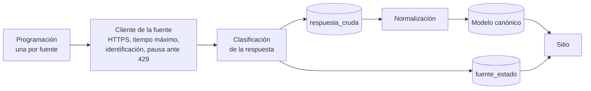
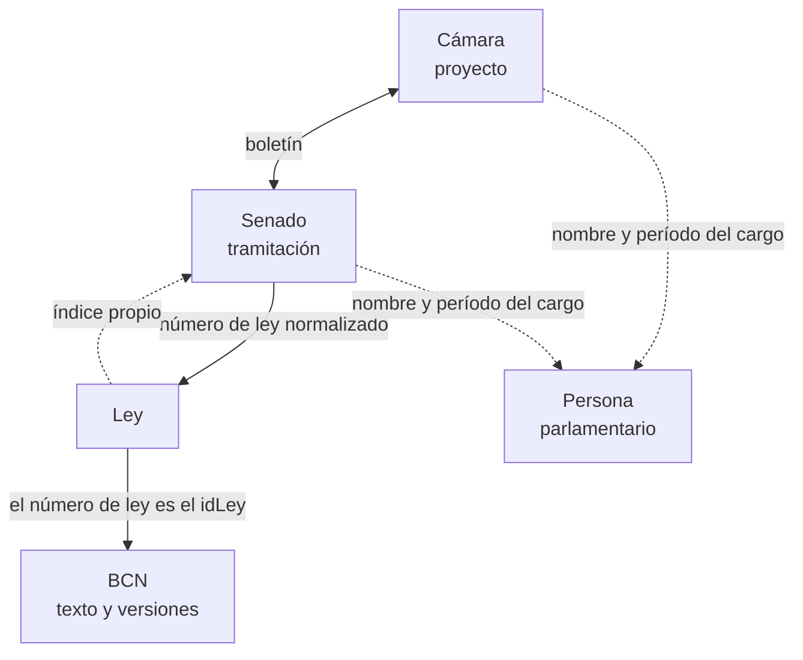
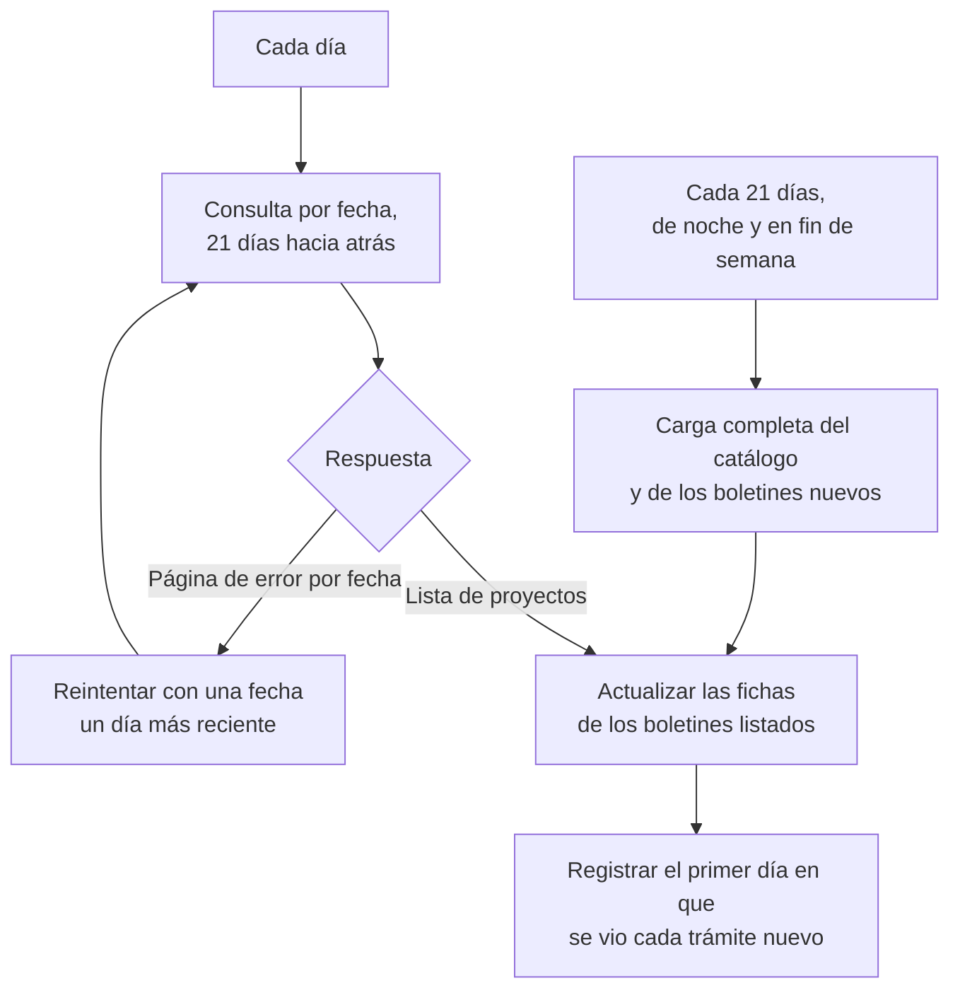
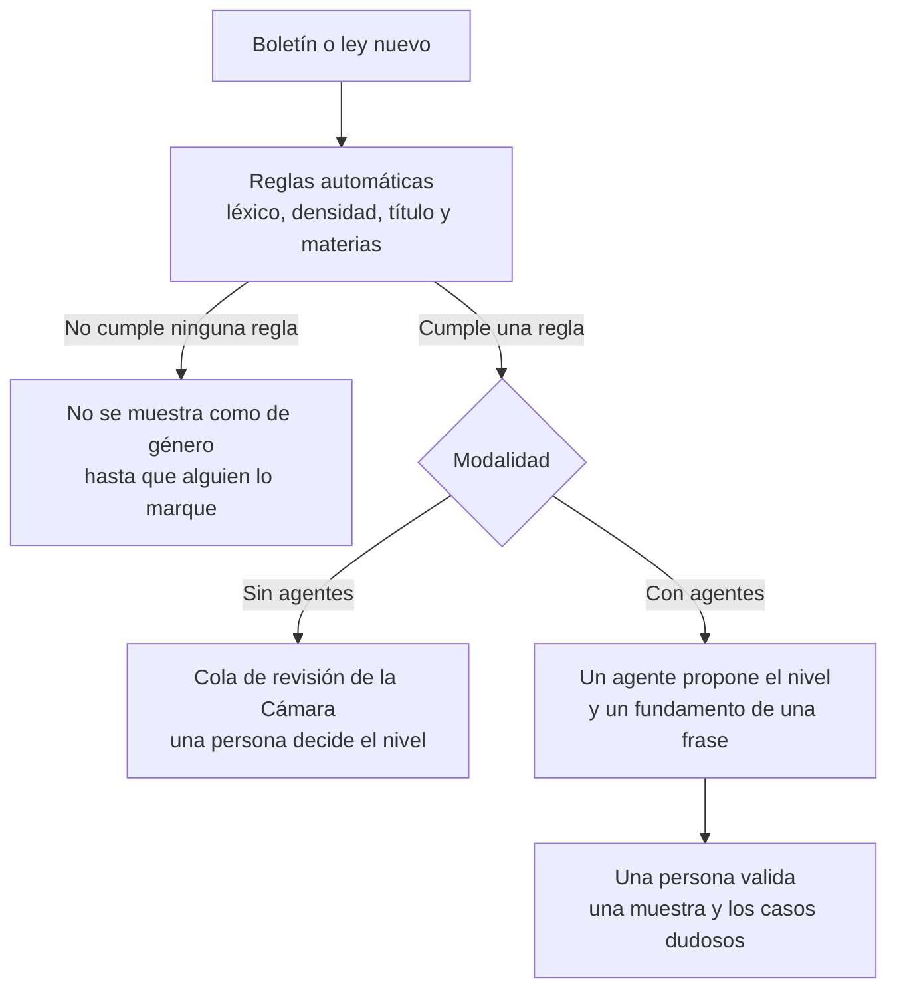
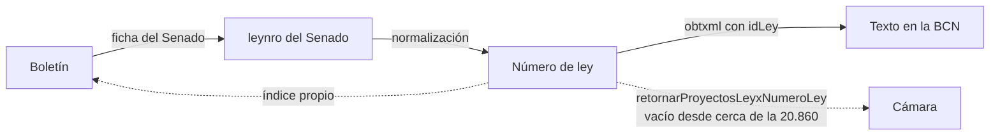
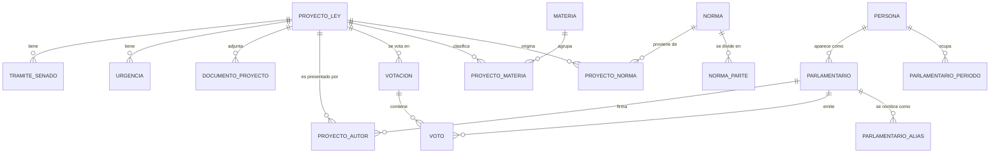

# Documentación técnica del Observatorio de Legislación de Género

Proyecto independiente de consulta pública de información legislativa de Chile.

Autor: Pedro Aravena. Estado: diseño y primera implementación, 2 de noviembre de 2026.

La Cámara de Diputadas y Diputados, el Senado y la Biblioteca del Congreso Nacional se citan como fuentes de datos. Ninguna de estas instituciones patrocina ni opera este sitio.

## Alcance

El sitio guarda una copia trazable de proyectos de ley, trámites, leyes y personas a partir de fuentes oficiales. Consulta esas fuentes mediante procesos programados y responde a quienes lo visitan desde su propia base. La selección temática de género aún requiere una regla editorial definitiva; los candidatos actuales son una propuesta de trabajo y no una clasificación validada por las fuentes.

## 1. Arquitectura e integración

### 1. Introducción

#### 1.1. Problema y pregunta de diseño

El Observatorio integra información de fuentes oficiales en una base propia, sincronizada por procesos programados. Las páginas públicas consultan esa base, muestran la fuente de cada dato y señalan cuándo se verificó por última vez.

A estas exigencias se suma una particularidad del Observatorio. Mientras las tres fuentes publican toda la actividad legislativa, el Observatorio solo se ocupa de las iniciativas relacionadas con temas de género, de modo que la integración también debe permitir seleccionar ese universo sin perder el vínculo con el registro original de cada fuente. En consecuencia, la pregunta que ordena este diseño es cómo mantener una réplica fiel, trazable y actualizada de tres fuentes heterogéneas, de manera que el sitio funcione aunque alguna de ellas no esté disponible cuando una persona lo visita.

#### 1.2. Fuentes cubiertas

La integración considera tres servicios oficiales. El portal `https://opendata.camara.cl/` reúne enlaces a varias fuentes, pero las consultas a la Cámara usan la dirección específica de su servicio.

| Fuente | Dirección del servicio | Qué aporta | Forma de acceso |
|---|---|---|---|
| Cámara de Diputadas y Diputados | `https://opendata.camara.cl/camaradiputados/WServices/` | Proyectos desde 1990 (18.519 boletines), autores, votaciones y diputados desde 1990 con sexo y militancia | Servicios SOAP 1.1 y consultas GET sobre HTTPS, sin credenciales |
| Senado | `https://tramitacion.senado.cl/wspublico/tramitacion.php` | Tramitación de ambas cámaras desde 1990, urgencias, votaciones nominales (escasas antes de 2010) y los 31 senadores en ejercicio | Documentos XML por GET sobre HTTPS, sin credenciales |
| BCN, plataforma LeyChile | `https://www.leychile.cl/Consulta/obtxml` | Texto vigente y versiones de las leyes desde la ley 1, de 1893 | Documentos XML por GET, con la exigencia de identificarse como navegador |

#### 1.3. Alcance de esta arquitectura

La regla para seleccionar iniciativas de género se documenta y revisa por separado. Esta arquitectura conserva la procedencia de cada selección y permite cambiar el criterio sin rehacer la ingesta.

El sitio y la búsqueda textual se construyen sobre los datos normalizados. El diseño actual usa PostgreSQL para almacenar y consultar la información. Si en el futuro se cambia el motor o el sistema de búsqueda, habrá que revisar sus índices y consultas específicas.

### 2. Principios de diseño

El diseño se apoya en tres principios para proteger la consulta pública frente a fallas de las fuentes y mantener la trazabilidad de los datos.

#### 2.1. Consulta de las fuentes en segundo plano

El Observatorio no consulta a la Cámara, al Senado ni a la BCN cuando una persona abre una página del sitio. Las consultas ocurren en procesos programados, y el sitio solo lee la base de datos propia. Dado que las fuentes pueden dejar de responder o limitar la cantidad de consultas, este principio convierte esas fallas en un problema de la sincronización y no del sitio, que sigue mostrando lo último que se guardó.

Sin embargo, mostrar datos antiguos sin advertirlo sería engañoso. Por ello, cada fuente tiene un estado visible, guardado en la tabla `fuente_estado` junto con su fecha de actualización, y el sitio lo muestra al lado de los datos, de manera que quien lo visita pueda distinguir una fuente caída de un error del Observatorio. La sección 2 de la matriz de contingencias define esos estados y el texto que acompaña a cada uno.

Este principio también condiciona la forma de reconocer los errores, porque las fuentes no los informan de manera uniforme. El Senado responde con el código HTTP 200, que normalmente significa éxito, incluso cuando devuelve una página de error, de modo que el sistema clasifica cada respuesta por su contenido y no por su código. La matriz de contingencias define siete clases de respuesta con ese criterio. La BCN, por su parte, responde con el código 429, que significa demasiadas solicitudes, cada vez que se le pide una ley que no tiene en su memoria intermedia. El 13 de octubre se pidieron leyes no almacenadas a distintos ritmos, y se obtuvieron respuestas 429 incluso a una consulta cada 30 segundos, de modo que ningún ritmo razonable evita ese límite. En consecuencia, el sistema no trata el 429 como un error sino como una espera esperable, y ante el primer 429 pausa la carga de la BCN entre 60 y 120 segundos antes de continuar.

#### 2.2. Respuestas guardadas sin alterar y modelo reconstruible

Toda respuesta se guarda tal como llegó, incluida la que resulta inválida, en la tabla `respuesta_cruda`. Junto a ella se registran la fuente, los parámetros de la consulta, la fecha y una huella del contenido, que es un código calculado a partir de los bytes de la respuesta y que cambia si cambia cualquier parte de ella. El modelo canónico se deriva de esas respuestas y cada fila conserva la referencia a la respuesta de la que salió, lo que permite rastrear cualquier dato del sitio hasta su origen (criterio A5).

De este principio se sigue una ventaja operativa importante. Si la normalización tiene un error, se corrige reprocesando lo ya guardado y no descargando todo de nuevo, lo que evita someter a las fuentes a consultas adicionales y protege la carga inicial, que en el caso de la BCN es lenta por el límite de consultas.

El versionamiento de los datos descansa en tres mecanismos complementarios. El primero es la conservación de cada respuesta con su fecha y su huella, que permite saber qué decía una fuente en cada momento. El segundo es el atributo `fechaVersion`, con el que la BCN identifica cada versión del texto de una ley. El tercero es el registro de los cambios de estructura de la base de datos. Cada cambio, como crear una tabla o agregar un campo, se escribe en un archivo de texto que forma parte del código fuente y que una herramienta llamada Liquibase aplica en orden sobre la base de datos. Los archivos permiten reconstruir la estructura en PostgreSQL y saber qué cambió y cuándo.

#### 2.3. Una respuesta vacía no borra datos

Una colección vacía o una respuesta sin contenido nunca elimina datos ya cargados. Este principio previene un modo de falla plausible, en el que una fuente responde sin resultados por un problema propio y el sistema, al interpretar ese vacío como la desaparición de los registros, borra una parte de la réplica. Dado que hoy ninguna de las tres fuentes informa expresamente que un registro fue eliminado, el Observatorio no tiene motivo para borrar nada a partir de una respuesta.

### 3. Arquitectura de la sincronización

Cada fuente tiene su propio proceso programado, independiente de los otros, de modo que el fallo de una no detiene a las demás (criterio A3). Dentro de cada proceso, las respuestas recorren siempre la misma secuencia. Se solicitan mediante un cliente propio de la fuente, se clasifican según su contenido, se guardan sin alterar, se normalizan hacia el modelo canónico y, finalmente, actualizan el estado de la fuente que el sitio exhibe.

A los pasos del diagrama se agregan tres componentes que se describen más adelante. El primero es el índice propio que relaciona cada ley con el proyecto que la originó (sección 4). El segundo es el resolutor de identidad de parlamentarios, con su cola de casos que requieren revisión manual (sección 8). El tercero es el emisor de alertas (sección 9).

Cuatro decisiones de construcción completan la arquitectura, y cada una responde a un requisito de trazabilidad o de robustez.

La primera se refiere a la forma de consultar los servicios de la Cámara, que usan el protocolo SOAP. Un servicio SOAP publica una descripción formal de sus operaciones, llamada WSDL, y la práctica habitual consiste en generar automáticamente a partir de ella un programa cliente que convierte cada respuesta en estructuras del lenguaje de programación, listas para usarse. Ese cliente automático, sin embargo, descarta el documento original una vez que lo convierte, y el documento original es justamente lo que el principio 2.2 exige guardar. Recuperarlo sería posible, pero exigiría intervenir el funcionamiento interno del cliente, lo que agrega complejidad sin beneficio para quien mantenga el sistema.

Por esta razón se decidió que cada cliente arme directamente la solicitud SOAP, reciba la respuesta tal como llega, la guarde y solo después la interprete, en un paso separado que trabaja sobre lo guardado. De esta manera la respuesta original queda intacta y puede reprocesarse sin volver a consultar a la Cámara. El costo de esta decisión es que los nombres de las operaciones y de sus parámetros se escriben a mano, de modo que un error en ellos solo se detecta al hacer la primera consulta real. Ese costo es bajo, porque el sistema usa pocas operaciones y todas con parámetros simples, como un año o un número de boletín. Para que un cambio del servicio no pase inadvertido, la descripción WSDL vigente se conserva junto al código fuente, las pruebas usan respuestas reales capturadas del servicio y el paso de interpretación falla de forma explícita cuando falta un elemento obligatorio, en lugar de entregar una lista vacía que podría confundirse con la ausencia de datos.

La segunda es que la carga es idempotente, lo que significa que repetirla sobre los mismos datos no inserta ni modifica filas. Esta propiedad permite reintentar una corrida interrumpida sin temor a duplicar información. Se verificó en la Cámara durante la prueba inicial de punta a punta inicial, y en el Senado para una ficha individual y para la carga completa reanudable (criterio A4).

La tercera es un bloqueo por fuente. Si una corrida está en curso, otra de la misma fuente se rechaza sin tocar los datos, lo que impide que dos procesos escriban a la vez sobre los mismos registros.

La cuarta es que el alojamiento definitivo aún no está elegido. Los tiempos medidos en la máquina de desarrollo podrían cambiar allí, por lo que deben verificarse después del despliegue.

### 4. Identificadores y relaciones entre fuentes

Ninguna de las tres fuentes fue diseñada para integrarse con las otras, de modo que antes de combinar sus datos es necesario resolver cuándo dos registros de fuentes distintas se refieren a lo mismo. El proyecto de ley es la entidad mejor resuelta, porque el número de boletín (por ejemplo, 11077-07) es común a la Cámara y al Senado. La relación entre un proyecto y la ley que originó requiere más trabajo, y la de un parlamentario con sus apariciones en cada fuente carece de una clave común, por lo que debe construirse con reglas propias. El mapa de fuentes e identificadores desarrolla estas relaciones en detalle.

En el diagrama, las líneas continuas representan relaciones que se resuelven con una clave compartida y las punteadas, relaciones que se resuelven con reglas propias del Observatorio. La tabla siguiente indica la regla de cada relación y la verificación con que cuenta.

| Relación | Regla | Verificación |
|---|---|---|
| Proyecto en la Cámara y en el Senado | Número de boletín | Coincidió en 40 de 40 boletines de una muestra aleatoria |
| Proyecto y ley que originó | Campo `<leynro>` del Senado, que llega como texto libre (`Ley N° 21.675`, `Ley Nº 19.029`) y se normaliza para extraer el número | La fecha de publicación coincidió con la de la BCN en las leyes 21.675 y 21.643 |
| Ley y su texto en la BCN | El número de ley es el parámetro `idLey` de la BCN, y se guarda además el identificador interno `normaId` | Las mismas dos leyes |
| Ley y proyecto, en sentido inverso | Índice propio, construido al recorrer las fichas del Senado y leer `<leynro>` | Necesario porque el servicio de la Cámara que debería resolverlo deja de responder desde cerca de la ley 20.860, según la medición del 12 de octubre, que el mapa de fuentes e identificadores describe |
| Parlamentario entre fuentes | Coincidencia por nombre, verificada contra los períodos en que la persona ejerció el cargo, con los casos no resueltos derivados a revisión manual | Sección 8 |

El índice inverso es indispensable por una razón concreta. Para el Observatorio, el punto de partida suele ser una ley de interés, y desde ella se quiere llegar a la tramitación que la originó. La BCN no permite hacer ese recorrido, porque no cita el boletín de manera fiable (el texto de la ley 21.643, por ejemplo, no lo menciona), y la Cámara tampoco, por la limitación de su servicio. Sin el índice construido a partir del Senado, en consecuencia, no habría forma de pasar de la ley a su proyecto.

### 5. Capacidades de cada fuente y detección de cambios

La estrategia de actualización depende de lo que cada fuente permite preguntar. Como las tres difieren en lo esencial, se describen primero por separado y luego se comparan.

#### 5.1. Cámara

La plataforma de datos abiertos de la Cámara entrega una lista anual de proyectos, con mociones y mensajes, y un detalle por boletín con autores y materias. Dado que ni la lista ni el detalle indican cuándo se modificó un registro, el cambio se detecta calculando la huella de cada proyecto en la lista anual y descargando el detalle solo de los proyectos nuevos o cuya huella cambió. Como propuesta, el año en curso se revisa a diario y los años cerrados con frecuencia semanal o menor, puesto que la actividad legislativa se concentra en los proyectos recientes.

En cuanto a la capacidad del servicio, la carga de las 18.519 fichas a una consulta por segundo, hecha entre el 14 y el 15 de octubre, terminó en 8,7 horas sin ninguna respuesta 429. Se observó, en cambio, que las consultas por HTTP sin cifrar (puerto 80) quedan colgadas sin respuesta, por lo que el cliente usa siempre HTTPS.

#### 5.2. Senado

El servicio de tramitación del Senado entrega la ficha completa de un proyecto a partir de su boletín, escrito sin el dígito final (`tramitacion.php?boletin=11077`). Ofrece además el parámetro `fecha=`, que devuelve todos los proyectos que tienen al menos un trámite fechado entre la fecha indicada y el día de hoy. Ese parámetro permite detectar cambios con una sola consulta diaria, pero presenta tres salvedades que condicionan el diseño.

La primera es que solo acepta fechas recientes. El 28 de octubre, la fecha 07/10 respondió correctamente y la 06/10 devolvió una página de error de 244 bytes con código 200, de modo que el límite vigente es de 21 días. No se sabe si ese límite es fijo, porque el 13 de octubre el mismo servicio rechazaba las fechas con más de un mes de antigüedad y con otro mensaje. La segunda es que todas las respuestas incluyen un trámite con fecha 25 de mayo de 2626, error evidente de los datos de origen que el sistema registra como anomalía sin interpretarlo como un cambio.

La tercera salvedad es la más importante. El parámetro filtra por la fecha que el Senado asigna al trámite y no por el día en que lo incorporó a la ficha. Por consiguiente, si un trámite se registra con retraso y con una fecha anterior al período consultado, la consulta diaria no lo ve. La sección 7.2 reconstruye la prueba en que este efecto dejó fuera dos boletines.

#### 5.3. BCN

La plataforma LeyChile publica el texto completo de cada ley, pero no ofrece una consulta liviana para saber si cambió, ya que pedir la norma equivale a descargar todo su texto. Por lo tanto, la revisión periódica debe descargar la norma y comparar dos valores con los guardados, su `fechaVersion` y la huella del contenido. Si cualquiera de los dos cambia, se actualiza el texto en el modelo canónico. Se usan ambos porque todavía no se ha comprobado que todo cambio del texto modifique también `fechaVersion`, asunto que mide el sondeo iniciado el 28 de octubre. A esta limitación se suma el límite de consultas ya descrito, que en un primer ensayo a ritmo rápido con leyes reales significó cerca de 1,65 minutos por ley, contando las pausas.

#### 5.4. Comparación de los mecanismos de detección

La tabla siguiente contrasta el mecanismo de detección de cada fuente con la restricción principal que se midió en ella.

| Fuente | Detección de cambios | Restricción principal medida |
|---|---|---|
| Cámara | Huella de cada proyecto en la lista anual, y detalle solo de lo nuevo o distinto | Ninguna, a una consulta por segundo durante 8,7 horas. El puerto 80 queda colgado |
| Senado | Consulta diaria por fecha con una ventana de 21 días, más una carga completa cada 21 días | La consulta por fecha omite trámites registrados con retraso. Cubrió 66 de 68 cambios en la prueba del 26 de octubre |
| BCN | `fechaVersion` y huella del texto de cada ley, revisadas por orden de antigüedad | Respuestas 429 sin un ritmo que las evite, y cerca de 1,65 minutos por ley en el ensayo rápido |

#### 5.5. Síntesis de factibilidad técnica

La tabla siguiente reúne el mecanismo de acceso, los identificadores, los formatos, la cobertura, la frecuencia de actualización, las restricciones técnicas y la disponibilidad observada en octubre de 2026.

| Criterio | Cámara | Senado | BCN |
|---|---|---|---|
| Mecanismo de acceso | SOAP 1.1 y GET sobre HTTPS, sin credenciales | GET sobre HTTPS, sin credenciales | GET sobre HTTPS, sin credenciales, identificándose como navegador |
| Identificador de origen | `NumeroBoletin`, además de un `Id` interno | Boletín, con el mismo formato que la Cámara | `idLey`, que es el número de ley, y `normaId` |
| Formato | XML, con algunos caracteres codificados dos veces, que el lector corrige | XML, y páginas HTML en las respuestas de error, siempre con código 200 | XML |
| Cobertura histórica verificada | Desde 1990, con 18.519 boletines | Desde el boletín 1-07, de 1990 | Desde la ley 1, de 1893, con vacíos sin cuantificar |
| Frecuencia de actualización en origen | No publicada. Medición en curso desde el 28 de octubre | No publicada. 68 de 2.499 boletines cambiaron en unos 11 días, con dos registros tardíos | No publicada. Medición en curso desde el 28 de octubre |
| Restricciones técnicas | El puerto 80 queda colgado, los errores llegan como texto plano y la lista anual no trae autores ni materias | La consulta por fecha acepta 21 días y filtra por la fecha del trámite | Límite de consultas (429) sin un ritmo que lo evite |
| Disponibilidad observada al 28 de octubre, desde la máquina de desarrollo y desde un servidor externo | 94,7 % y 100 % | 93,6 % y 100 % | 92,6 % y 98,8 % para una ley en memoria intermedia, 81,8 % y 94,0 % para una consulta directa |
| Tiempo de respuesta observado | Entre 0,07 y 2,6 segundos por operación | Entre 0,56 y 1,4 segundos por boletín, y hasta 17 segundos la consulta por fecha | Entre 0,1 y 0,3 segundos para una ley en memoria intermedia, y cerca de 1,65 minutos por ley, con pausas, en el ensayo rápido |

La conclusión es que las tres fuentes pueden integrarse técnicamente, aunque cada una impone una restricción que condiciona el diseño. En la Cámara es la ausencia de una fecha de modificación, que obliga a detectar cambios mediante huellas. En el Senado es el punto ciego de la consulta por fecha, que se cubre con la carga completa periódica (sección 7.3). En la BCN es el límite de consultas, que obliga a una carga lenta y limitada a las leyes que interesan al Observatorio. Ninguna de estas restricciones impide la integración. Sin embargo, la disponibilidad medida desde el servidor externo proviene de pocas observaciones, por lo que todavía no basta para comprometer un nivel de servicio.

#### 5.6. Requisitos de acceso

Los requisitos técnicos para consultar las fuentes son pocos y se resumen en la tabla siguiente.

| Requisito | Cámara | Senado | BCN |
|---|---|---|---|
| Credenciales | Ninguna | Ninguna | Ninguna |
| Cabeceras de la solicitud | Ninguna especial | Ninguna especial | Identificación como navegador (`User-Agent`), porque la identificación por defecto de la herramienta curl recibe un rechazo 401 |
| Protocolo | Solo HTTPS | HTTPS | HTTPS |
| Ritmo probado sin respuestas 429 | Una consulta por segundo durante 8,7 horas | Una consulta por segundo durante 8,7 horas | Ninguno seguro. A una consulta cada 20 segundos hubo dos 429 en 197 leyes |

Antes de publicar la réplica se deben revisar los términos de uso y las condiciones de reutilización de los datos de cada fuente; esa revisión sigue pendiente. También se debe medir desde el alojamiento definitivo el acceso a las tres fuentes: desde un servidor externo, una consulta a la Cámara tardó cerca de 11 segundos y no se investigó la causa.

### 6. Carga inicial

La carga inicial reconstruye la historia legislativa desde 1990 en una sola corrida controlada, reanudable y fuera del horario de mayor uso de las fuentes. Sus cuatro pasos siguen un orden fijo, porque cada uno necesita lo que produjo el anterior.

En primer lugar se cargan los datos de referencia de parlamentarios, con 1.820 personas y 3.865 cargos obtenidos de las Reseñas biográficas de la BCN, para que los autores y votantes puedan reconocerse en el momento en que se leen. En segundo lugar se cargan las listas anuales de la Cámara, de 1990 a 2026, y el detalle de los 18.519 boletines. En tercer lugar se carga la tramitación de esos mismos boletines en el Senado, con sus votaciones, y el número de ley que aparece en cada ficha permite construir el índice que va de la ley al proyecto. Por último se cargan los textos de la BCN, pero solo de las leyes que pertenecen al universo del Observatorio.

La carga de textos de la BCN usa una lista de leyes candidatas; cada inclusión registra la regla o persona que la propuso. La lista de trabajo tiene 2.155 proyectos y leyes y aún requiere revisión humana. Combina señales del título, las materias, la comisión y el texto. Parte de la clasificación preliminar se hizo con Claude Sonnet 5.5 y todavía no está validada. El volumen de esta lista determina la duración de la carga: a una consulta por minuto, mil leyes tomarían cerca de 17 horas y diez mil, cerca de siete días.

La carga de las fichas de los 18.519 boletines en la Cámara y el Senado ya se midió entre el 14 y el 15 de octubre, a una consulta por segundo en cada fuente y en paralelo. Terminó en 8,7 horas sin ninguna respuesta 429 y sin que se activara el corte por fallas consecutivas, y las 43 fallas transitorias, incluido un error 500 de la Cámara, se resolvieron al reintentar. Este resultado, sin embargo, no demuestra que las fuentes toleren ese ritmo indefinidamente ni con otro volumen. La misma carga mostró que las fichas casi no traen materias desde 2019 o 2020, y que en 2025 y 2026 ninguna las trae, por lo que el modelo no puede suponer que ese campo exista.

### 7. Sincronización periódica y actualización de los datos

Esta sección responde tres preguntas. La primera es cómo se mantienen al día los boletines y las leyes que el Observatorio ya conoce. La segunda es cómo se incorporan los nuevos. La tercera es qué parte de ese proceso podría apoyarse en agentes de inteligencia artificial y qué ocurre si no se cuenta con ellos. En cada caso se distingue lo medido de lo propuesto.

#### 7.1. Actualización de la Cámara y de la BCN

Para la Cámara se propone revisar a diario el año en curso y con menor frecuencia los años cerrados. Dado que su servicio no permite filtrar por fecha, la revisión compara la huella de cada proyecto en la lista anual y pide el detalle solo de los nuevos o distintos.

Para la BCN se propone una revisión semanal de las leyes seleccionadas, comenzando por las que llevan más tiempo sin revisarse y con pausas ante cada respuesta 429. Como se explicó en la sección 5.3, cada revisión descarga el texto completo y compara `fechaVersion` y la huella con los valores guardados.

En ninguna de las dos fuentes se ha medido cuántos cambios podría omitir el mecanismo propuesto. Para estimarlo, el 28 de octubre comenzó un sondeo que elige 300 proyectos de la Cámara y 300 leyes de la BCN, los consulta todos los días durante 21 días y registra cuándo cambia cada uno. Sus resultados, esperados hacia el 18 de noviembre, mostrarán con qué frecuencia cambian realmente los registros de cada fuente y permitirán confirmar o ajustar los intervalos propuestos.

#### 7.2. Omisiones de la consulta por fecha del Senado

El Senado requiere una estrategia propia, porque su consulta por fecha detecta cambios con una sola solicitud diaria, pero tiene un punto ciego que una prueba permitió medir.

El 15 de octubre se guardó una línea base con la ficha de 2.499 boletines, que incluía todos los de 2024 en adelante y 300 anteriores elegidos al azar. El 26 de octubre se volvieron a descargar esas fichas y se compararon con la respuesta de la consulta `fecha=13/10`. De los 68 boletines que habían cambiado, la consulta por fecha trajo 66 y omitió dos, el 16858-15 y el 18693-06.

Para entender la omisión se compararon la ficha guardada y la ficha actual de ambos boletines. En el 16858-15 había aparecido un oficio y la aprobación en general del proyecto en el segundo trámite, con fecha 5 de octubre. En el 18693-06 había aparecido el acuerdo de la Sala de enviar el proyecto a una comisión, con fecha 30 de septiembre. Ambos trámites tenían una fecha anterior al 13 de octubre, que era el inicio del período consultado, y se incorporaron a la ficha después del 14 de octubre, es decir, con al menos 9 y 14 días de retraso respectivamente. Dado que la consulta filtra por la fecha del trámite y no por el día de su registro, ninguno de los dos podía aparecer en ella.

La revisión de los 68 boletines confirmó que se trata de una regla y no de un accidente. Los 68 tenían al menos un trámite nuevo, de modo que ninguno cambió solo en urgencias, oficios u otras secciones. De ellos, los 66 cuyo trámite nuevo tenía fecha igual o posterior al 13 de octubre aparecieron en la consulta, y los 2 cuyo trámite nuevo tenía fecha anterior no aparecieron. Esta prueba, con todo, no midió cuánto puede llegar a tardar el registro de un trámite ni con qué frecuencia ocurre, y en el caso del 18693-06 el retraso pudo superar los 21 días.

#### 7.3. Consulta diaria y carga completa del Senado

Dado que la consulta por fecha no basta como única vía de actualización, el 28 de octubre se decidió combinar dos procesos distintos. Conviene no confundirlos, porque cada uno se describe con un número de días diferente, que la tabla siguiente separa.

| | Consulta diaria por fecha | Carga completa de respaldo |
|---|---|---|
| Qué hace | Pide al Senado los proyectos con trámites fechados desde el día más antiguo que acepta. Como la respuesta ya trae la ficha completa de cada proyecto, basta compararla con lo guardado | Vuelve a descargar, uno por uno, los 18.519 boletines del catálogo histórico y los nuevos que ya están en la base, y los compara con lo guardado |
| Cuándo se ejecuta | Todos los días | De noche y preferentemente en fin de semana |
| Número de días que la describe | Ventana de 21 días hacia atrás, que es el máximo que el Senado acepta hoy | Intervalo de 21 días entre una carga completa y la siguiente |
| Costo medido | Una consulta, de cerca de 2,3 MB en la prueba | La primera corrida procesó 18.622 boletines entre la 01:00 y las 09:44 del 31 de octubre, incluidas las pausas |
| Qué detecta | Todo trámite cuya fecha esté dentro de los últimos 21 días, aunque se haya registrado tarde | Trámites registrados con más de 21 días de retraso, boletines archivados que se reactivan y cualquier otro cambio que la consulta diaria no vea |
| Estado | Implementada y en operación | Implementada, con una primera corrida completa exitosa |

Con esta combinación, un trámite registrado con más de 21 días de retraso escapa a la consulta diaria, pero aparece en la siguiente carga completa, siempre que esta termine correctamente. Por consiguiente, el intervalo de 21 días acota el tiempo adicional que ese dato puede permanecer desactualizado. Quedan fuera de esta cobertura solo los cambios que tampoco ve la carga completa, como una modificación que el Senado revierta entre dos cargas.

El intervalo de 21 días se considera razonable porque los cambios observados se concentran en los boletines recientes y en tramitación. En la prueba del 26 de octubre, los 68 boletines modificados estaban en tramitación y eran de 2024 en adelante (45 de 2026, 8 de 2025 y 15 de 2024), mientras que los 300 boletines anteriores a 2024 no registraron ningún cambio. Este resultado no demuestra que los boletines antiguos nunca cambien, pero indica que el riesgo de una carga cada 21 días es bajo. Como referencia del tamaño de cada grupo, la línea base contiene 7.443 boletines en tramitación, 6.537 archivados, 4.051 publicados y cerca de 490 en otros estados. Si más adelante la duración de la carga completa resultara un problema, podría alternarse con una carga solo de los boletines en tramitación, que tomaría unas 2 horas, aunque esta alternativa no se adopta por ahora.

La decisión de mantener o espaciar la carga completa se tomará con evidencia, para lo cual el sistema registra, en cada trámite, el retraso entre su fecha y el primer día en que el Observatorio lo vio. Esa revisión requiere tres tipos de evidencia. La primera es la distribución de ese retraso, que mostrará cuántos trámites se registran con más de 21 días y que se medirá durante tres o cuatro semanas. La segunda es si las cargas completas encuentran cambios que la consulta diaria no recupera. La primera carga, terminada el 31 de octubre, detectó un cambio de subetapa antes de la consulta diaria de ese mismo día, que también lo recibió. Por tanto, ese caso no demuestra una omisión de la consulta por fecha. Si varias cargas sucesivas no encuentran omisiones, el intervalo podría ampliarse, por ejemplo a una revisión trimestral, y si las encuentran, cada una se registra y genera una alerta. La tercera es la frecuencia con que se reactivan boletines archivados o cambian secciones sin un trámite nuevo, casos que la consulta por fecha podría omitir aun sin retraso. Solo con las tres mediciones podrá decidirse si la carga completa deja de ser necesaria.

#### 7.4. Incorporación de boletines y leyes nuevos

La misma prueba del 26 de octubre mostró que la consulta por fecha también trae los boletines nuevos. De los 198 proyectos de la respuesta, 81 no estaban en la línea base, y 79 de ellos tenían un número mayor que el máximo de la línea base porque habían ingresado desde el 19 de octubre. Los otros dos, el 18654-07 y el 18731-07, tenían un número menor y tampoco estaban en la línea base, sin que se haya investigado por qué. Para no depender de una sola vía, el diseño compara además cada día la lista anual de la Cámara con lo que ya existe en la base, y todo boletín que falte se trata como nuevo.

En el caso de las leyes, un proyecto que se convierte en ley trae su número en la ficha del Senado. Con ese número se descarga el texto desde la BCN, que desde entonces entra en la revisión semanal de la sección 7.1. Esta vía tiene un punto ciego, que es la ley que no proviene de un boletín conocido, como ocurrió con las leyes 20.143 y 20.233, y no se ha verificado si la BCN publica una lista de leyes nuevas que permita cubrirlo. En todos los casos, un boletín o una ley nuevos pasan por la regla de selección de las secciones 7.5 y 7.6 antes de mostrarse en el Observatorio.

#### 7.5. Clasificación de género de lo nuevo, con y sin agentes

La descarga y la detección de cambios descritas hasta aquí no usan inteligencia artificial. Lo que puede variar es la forma de decidir si un boletín o una ley nuevos corresponden al tema de género. Para esa decisión se usa la escala de niveles del criterio de trabajo. En el nivel N1 el género es el tema de la ley, en el N2 una parte expresa de la ley trata de género, el N3 corresponde a casos de borde con un efecto indirecto que debe comprobarse en el texto, y el N4 reúne lo que no tiene relación con el género o solo lo menciona de pasada, y queda excluido.

El diseño admite dos modalidades, que escriben en las mismas tablas. En ambas se registran el nivel asignado, la señal que lo originó y quién lo asignó, en un campo `codificador` que admite tres valores. El valor `regla` indica que el nivel lo asignó una regla automática, `claude` indica que lo propuso el modelo de lenguaje Claude, de Anthropic, y `desarrollador` indica que lo asignó o corrigió una persona. Gracias a ello, el Observatorio puede operar sin agentes y activar más adelante la modalidad con agentes, o renunciar a ella, sin rehacer nada.

En la modalidad sin agentes se aplican reglas automáticas. Estas buscan los términos de un léxico de género en el título, las materias y, cuando existe, el texto, y miden la densidad de esos términos, definida como su número por cada 10.000 caracteres. Todo lo que cumple una regla entra a una cola de revisión del equipo de la Cámara junto con la razón por la que entró, que puede ser un término, una densidad o un pasaje, y una persona decide el nivel. Lo que no cumple ninguna regla no se muestra como de género hasta que alguien lo marque.

Para estimar la precisión de estas reglas se leyeron, entre el 21 y el 23 de octubre, las leyes que habían quedado fuera de la lista candidata. La lectura se hizo con Claude Sonnet 5.5, un modelo de lenguaje de Anthropic, y sus resultados son preliminares hasta que se validen manualmente. La tabla siguiente muestra, para cada tramo de densidad o de cantidad de términos, cuántas leyes resultaron de nivel N2 o N3.

| Tramo de la ley | Leídas | Resultaron N2 o N3 |
|---|---|---|
| Densidad de 3 o más | 174 | 88 (51 %) |
| Densidad menor que 3, con 5 o más términos | 102 | 61 (60 %) |
| 3 o 4 términos | 102 | 42 (41 %) |
| 2 términos | 88 | 23 (26 %) |
| 1 término | 178 | 34 (19 %) |
| Ningún término (muestra de 100) | 100 | 0, lo que permite afirmar con 95 % de confianza que la proporción real no supera el 3 % |

La tabla muestra que, en los tramos con pocos términos, entre 5 y 8 de cada 10 leyes resultan ajenas al tema. Una regla laxa aumenta la revisión manual; una regla estricta puede omitir leyes pertinentes. El umbral debe quedar explícito y revisarse con una muestra validada.

En la modalidad con agentes, el primer paso es el mismo, pero antes de llegar a la cola interviene un agente. Se entiende por agente un programa que usa un modelo de lenguaje para ejecutar una tarea por sí mismo, en este caso leer un grupo de leyes y entregar un informe con el nivel propuesto para cada una. El agente lee el texto o los pasajes marcados y propone un nivel con un fundamento de una frase, y la persona valida una muestra y los casos dudosos en lugar de revisarlo todo. Este fue el procedimiento usado para las 644 leyes leídas. Su ventaja es que la cola llega con el fundamento escrito, lo que permite usar reglas más laxas sin sobrecargar a quien revisa. Tiene, sin embargo, costos y riesgos. Depende de un servicio de inteligencia artificial con costo de uso. Además, los agentes cometieron errores medibles, con 7 correcciones en 174 leyes y una falla en el manejo de las tildes que ocultó algunos pasajes. Por último, el criterio para los casos límite sigue siendo humano, porque varias preguntas de fondo, como el nivel que corresponde a las leyes sobre delitos sexuales o dónde termina un efecto indirecto de género, son decisiones metodológicas que requieren criterio humano.

#### 7.6. Regla de selección y carga de trabajo de la modalidad sin agentes

La tabla siguiente compara cinco reglas posibles, de la más estricta a la más laxa, según la cantidad de casos nuevos que llevarían a la cola de revisión. Las cifras son promedios anuales, de 2022 a 2025 para los boletines y de 2020 a 2025 para las leyes, y combinan el análisis del texto con la señal del título y las materias. Cada regla incluye todo lo que captura la anterior.

| Regla (entra a la cola si...) | Boletines por año | Leyes por año | Total por año | Por mes | Por semana |
|---|---|---|---|---|---|
| B1, densidad de 3 o más | 194 | 18 | 212 | 18 | 4,1 |
| B2, lo anterior o 5 o más términos | 216 | 23 | 238 | 20 | 4,6 |
| B3, lo anterior o 3 o 4 términos | 236 | 26 | 262 | 22 | 5,0 |
| B4, lo anterior o 2 términos | 283 | 29 | 311 | 26 | 6,0 |
| B5, lo anterior o 1 término | 388 | 34 | 422 | 35 | 8,1 |

Como punto de partida se adoptó la regla B5, que envía a la cola todo lo que contenga al menos un término del léxico, además de lo que marque la señal de título y materias. La razón es que, aunque trae más falsos positivos, la mayoría se descarta con facilidad, como las leyes generales o los boletines claramente ajenos al tema, y a cambio se pierde menos. El umbral puede ajustarse según la carga real de revisión y la proporción de casos pertinentes.

Estas cifras tienen cuatro límites. En primer lugar, una ley casi siempre proviene de un boletín que ya pasó por la cola, de modo que la suma de boletines y leyes cuenta algunos casos dos veces y el total es un máximo. En segundo lugar, la proporción de falsos positivos solo se estimó en las leyes, y con la clasificación sin validar ya mencionada, por lo que se desconoce en los boletines. En tercer lugar, 2024 y 2025 tuvieron menos boletines (800 y 707) que 2022 y 2023 (843 y 888). En cuarto lugar, las cifras describen solo el flujo nuevo, puesto que el acervo histórico ya se leyó y forma parte de la lista candidata. Como referencia, la lista depurada contiene entre 112 y 176 boletines por año, cerca de 3 por semana, cifra que no debe confundirse con la de la cola de la tabla.

La tabla siguiente muestra el rendimiento de cada regla sobre las leyes. Se calculó con las 248 leyes que la clasificación preliminar consideró de nivel N2 o N3 y que la búsqueda por títulos no había detectado.

| Regla | Leyes en la cola | Clasificadas N2 o N3 | Clasificadas N4 | Proporción capturada de las 248 |
|---|---|---|---|---|
| B1 | 174 | 88 | 86 | 35 % |
| B2 | 276 | 149 | 127 | 60 % |
| B3 | 378 | 191 | 187 | 77 % |
| B4 | 466 | 214 | 252 | 86 % |
| B5 | 644 | 248 | 396 | 100 % |

Quedan dos asuntos metodológicos: asignar la revisión de los casos pendientes y escribir una regla para distinguir N3 de N4, especialmente ante efectos indirectos de género.

### 8. Identidad de parlamentarios

Las fuentes nombran a los parlamentarios con texto libre y sin una clave común, de modo que el vínculo entre una persona y sus apariciones como autora o votante debe construirse. La solución usa tres tablas. La tabla `persona` registra quién es cada parlamentario y sus identificadores en cada fuente. La tabla `parlamentario_alias` asocia cada forma en que el Senado escribe un nombre con una persona, de manera automática o manual. La tabla `parlamentario_periodo` registra los cargos que cada persona ocupó. Esta última se llena por anticipado con las Reseñas biográficas de la BCN, que permiten comprobar si una persona ejercía el cargo en la fecha de un voto o de una firma.

La regla central es que el sistema nunca adivina. Un nombre que coincide con más de una persona, o con ninguna, queda sin resolver y pasa a una cola de revisión manual, y cada enlace manual se guarda para reutilizarlo en las cargas siguientes. En una muestra de 300 boletines medida el 13 de octubre, 717 de 717 votantes del Senado y 1.044 de 1.045 autores coincidieron por nombre con una única persona, y esa persona ejercía el cargo en el año del voto o del ingreso del proyecto. La única excepción fue Gajardo Chacón en 2002, que quedó para revisión manual, y el único autor sin candidato, Edwards, ya se resolvió manualmente. En el caso de la Cámara, los 633 registros de diputados corresponden a 632 personas, todas con ficha en la BCN. De ellas, 627 se enlazaron directamente y cinco requirieron resolver diferencias de grafía o de apellido.

Esta medición tiene un límite que conviene explicitar. Solo se verificó que la persona encontrada ejerciera el cargo en la fecha correspondiente, pero no se midió cuántos enlaces por nombre son erróneos. Por consiguiente, padres e hijos o hermanos con el mismo nombre y períodos superpuestos quedarían como casos ambiguos, situación que no apareció en la muestra. En cuanto al sexo, la Cámara lo entrega para los diputados, mientras que para los senadores se deriva de las Reseñas de la BCN y se registra como dato derivado, de modo que nunca se confunde con un dato de la fuente. Por tratarse de datos personales que ninguna pantalla necesita, no se almacenan el RUT ni la fecha de nacimiento.

### 9. Observabilidad y alertas

La tabla `fuente_estado` guarda, para cada fuente, su estado, la última sincronización completa, la última respuesta válida y el motivo del último fallo, y el sitio muestra el estado y la fecha junto a los datos (criterio A8). El 13 de octubre se fijaron umbrales de partida, que deberán ajustarse con datos reales. Según ellos, una fuente pasa al estado `retrasada` y genera una alerta (criterio A6) cuando lleva dos días sin una sincronización completa, en el caso de la Cámara y del Senado, o siete días, en el caso de la BCN, cuya revisión es semanal.

Además de los retrasos, generan alerta tres situaciones. La primera es el estado `contrato_roto`, que indica que una fuente cambió el formato de sus respuestas. La segunda es la clase `llamado_invalido`, que indica una consulta mal formada por el propio sistema. La tercera es la indisponibilidad de la base de datos del Observatorio. Una respuesta 429, en cambio, no genera alerta, porque forma parte del funcionamiento normal de la BCN.

El canal previsto es un correo electrónico al responsable técnico del proyecto. Al traspasar el sistema, la Cámara definirá el destinatario y podrá elegir otro canal. Por eso, el destinatario y el servidor de correo se configuran como variables del entorno de ejecución y no se escriben en el código. Como propuesta, esas variables son `ALERTAS__DESTINATARIOS`, con una lista de direcciones separadas por comas, y el grupo `ALERTAS__SMTP__*`, con el servidor, el puerto, el usuario, la clave y el remitente, y la clave se mantiene fuera del repositorio. Para no saturar el correo, se envía un mensaje por incidente y no por cada reintento, otro cuando el incidente se resuelve y un resumen diario si hay fuentes en espera o retrasadas que no alcanzaron a generar alerta. Si el correo no puede enviarse, el fallo queda registrado en `fuente_estado` y se reintenta.

La medición de disponibilidad complementa estas alertas, pero no las reemplaza. Cada cuatro horas se consulta cada fuente desde la máquina de desarrollo y desde un servidor externo, y en la BCN se agrega una consulta que evita la memoria intermedia. La tabla siguiente muestra el porcentaje de respuestas válidas al 28 de octubre.

| Fuente | Máquina de desarrollo | Servidor externo |
|---|---|---|
| Cámara | 94,7 % | 100 % |
| Senado | 93,6 % | 100 % |
| BCN, ley en memoria intermedia | 92,6 % | 98,8 % |
| BCN, consulta directa | 81,8 % | 94,0 % |

Estas cifras requieren tres aclaraciones. En la BCN, los errores 429 y 502 son fallas reales de la fuente. En cambio, los cinco momentos en que fallaron todas las consultas desde la máquina de desarrollo se atribuyen a la red local y no a las fuentes. Por otra parte, la fila de la BCN con memoria intermedia mide la red de distribución de contenidos con una ley ya almacenada, por lo que no representa la descarga de una ley cualquiera. Finalmente, la medición desde los servidores de GitHub se interrumpió el 13 de octubre al agotarse la cuota gratuita de minutos. En consecuencia, las observaciones todavía son pocas para estimar una disponibilidad estable.

### 10. Límites y mediciones pendientes

Las mediciones disponibles todavía no permiten fijar con certeza todos los intervalos de consulta ni la cobertura de cada fuente.

#### 10.1. Mediciones de alcance limitado

Los límites de consultas de la Cámara y del Senado solo se probaron hasta una consulta por segundo durante 8,7 horas, por lo que se desconoce qué ocurre con ritmos mayores o períodos más largos. En la BCN, la carga de las 197 leyes de la primera lista candidata, construida solo a partir de los títulos, hecha el 17 de octubre a una consulta cada 20 segundos, resultó correcta en las 197 leyes y tomó 4 horas y 13 minutos, con 55 leyes servidas desde la memoria intermedia y dos respuestas 429 resueltas con pausa. No se ha medido, sin embargo, a qué ritmo intermedio entre ese y el del ensayo rápido comienzan los rechazos.

La consulta por fecha del Senado cubrió 66 de 68 cambios en la prueba del 26 de octubre, y la sección 7.2 explica por qué los dos restantes quedaron fuera. Esa prueba no mide la distribución del retraso de registro ni demuestra que toda omisión futura tenga la misma causa. Al 28 de octubre, la consulta diaria acumulaba 16 corridas con 10 cambios detectados y ninguna omisión, muestra que todavía es pequeña. Desde el 29 de octubre el sistema registra el primer día en que ve cada trámite. Hasta el 1 de noviembre hay tres observaciones posteriores a la línea base, todas del mismo boletín y con un retraso de diez días respecto de la fecha declarada del trámite. Todavía no permiten estimar una distribución general.

La primera carga completa del Senado terminó correctamente el 31 de octubre y encontró una diferencia que la consulta diaria de ese día aún no había visto. Se trató de un cambio de subetapa del boletín 18762-07 entre el 30 y el 31 de octubre, sin cambios en sus tres trámites. La consulta diaria posterior también trajo la nueva subetapa. Esa corrida no basta por sí sola para estimar la duración habitual de la carga ni la cantidad de cambios que se omitirían en períodos futuros. Tampoco se sabe si los boletines antiguos o archivados cambian con más frecuencia que lo observado (ninguno de 300), ni por qué los boletines 18654-07 y 18731-07 faltaban en la línea base, ni si una consulta diaria de 2,3 MB se mantendrá sin respuestas 429 en el largo plazo.

Otras mediciones quedaron incompletas. No se ha medido con qué frecuencia cambia la `fechaVersion` de la BCN en las leyes modificadas. La disponibilidad de votaciones nominales por año se observó solo en una muestra de 300 boletines, con 2 de 75 en la década de 1990 y 14 de 75 entre 2010 y 2019, de modo que falta recorrer los 18.519. El detalle de la Cámara con autores y votaciones se revisó solo en 2017 y 2022, por lo que se desconoce desde qué año está completo. Por último, no se ha ejecutado el recorrido de las leyes 19.000 a 21.700 en la BCN para cuantificar los vacíos de numeración.

#### 10.2. Anomalías de las fuentes

El enlace al texto del mensaje o la moción que publica el Senado (`link_mensaje_mocion`) falló cinco de cinco veces con un error 522 el 15 de octubre y respondió correctamente quince de quince veces el 16, con documentos PDF o Word de unos 500 KB. Se trata de una falla pasajera de frecuencia desconocida, por lo que el diseño la tolera mediante reintentos.

Asimismo, 150 de los 3.539 mensajes del Senado, que son proyectos presentados por el Presidente de la República, registran nombres de parlamentarios como autores, por ejemplo Gajardo Chacón en 2000 y 2002, cuando no era diputado. Dado que no se sabe qué representa ese nombre, la regla adoptada es enlazar autores solo en las mociones, que son los proyectos presentados por parlamentarios, y registrar la anomalía en los mensajes. Por último, faltan 213 números en la secuencia de boletines, y no se ha confirmado que correspondan a números que nunca se asignaron a un proyecto.

#### 10.3. Asuntos abiertos

Antes de publicar quedan cinco asuntos abiertos.

Las fuentes iniciales son la Cámara, el Senado y la BCN; esa lista se puede revisar. El criterio temático y la lista candidata son provisionales. Falta medir los tiempos de carga desde el alojamiento definitivo, revisar los términos de reutilización de los datos y definir el canal de alertas.

Por otra parte, ninguna de las tres fuentes publica con qué frecuencia actualiza sus datos. En el Senado, la prueba del 26 de octubre mostró que el 2,7 % de los boletines de la muestra (68 de 2.499) cambió en unos 11 días, todos ellos en tramitación y de 2024 en adelante, lo que da una idea del ritmo de cambio. Para la Cámara y la BCN aún no existe una medición equivalente, porque sus sondeos siguen en curso. Esta falta de evidencia no impide el diseño, ya que la combinación de consulta diaria y carga completa funciona con cualquier frecuencia de cambio en origen, pero sí limita la certeza con que pueden fijarse los intervalos.

### 11. Criterios de aceptación

Los criterios de aceptación deben poder verificarse por un tercero. La tabla siguiente indica, para cada uno, cómo se prueba y en qué etapa del plan de trabajo. A la fecha solo se cumple, en parte, el criterio A4, de modo que los demás describen procedimientos de verificación y no resultados.

| N.º | Criterio | Cómo se verifica | Cuándo |
|---|---|---|---|
| A1 | Ninguna petición del sitio provoca una consulta a la Cámara, el Senado o la BCN | Prueba automática en la integración continua, con el sitio y la API funcionando, la salida hacia las fuentes bloqueada y las páginas respondiendo con los datos cargados | Antes de publicar |
| A2 | Con una fuente caída, el sitio responde y muestra el estado de esa fuente y la fecha de su última actualización | Fuente simulada que no responde, y revisión de la ficha y del pie de página | Antes de publicar |
| A3 | Una respuesta 429 de la BCN no se registra como error ni detiene a las otras fuentes | Fuente simulada que responde 429, revisión del estado `en_espera` y comprobación de que la Cámara y el Senado completan su corrida | Antes de publicar |
| A4 | Repetir una carga sobre los mismos datos no inserta ni modifica filas | Doble carga en la prueba de punta a punta de la Cámara y repetición de una ficha del Senado | Cumplido para la Cámara y para una ficha del Senado. Falta extenderlo a las cargas completas y a la BCN |
| A5 | Cada fila del modelo canónico puede rastrearse hasta la respuesta original | Consulta de ejemplo documentada | Antes de publicar |
| A6 | Si la sincronización falla o se retrasa más que el umbral (dos días en la Cámara y el Senado, siete en la BCN), quien opera recibe una alerta | Simulación de la falla y verificación de la alerta | Antes de publicar, una vez definido el canal |
| A7 | Una respuesta con formato inesperado (HTML o JSON en lugar de XML) se rechaza y se guarda sin alterar, sin llegar al modelo canónico | Pruebas con las respuestas de error reales ya capturadas, que son el error 500 en texto de la Cámara, la página HTML del Senado y el 429 en JSON de la BCN | Antes de publicar |
| A8 | Cada pantalla con datos muestra la fuente y la fecha de actualización | Revisión visual | Antes de publicar |
| A9 | Una respuesta vacía no borra datos ya cargados | Carga de un boletín y una ley, simulación de una respuesta vacía de cada fuente y comprobación de que los datos permanecen | Antes de publicar |
| A10 | La consulta diaria del Senado nunca pide una fecha anterior a la ventana que el Senado acepta. Si recibe la página de error por fecha, reintenta con un día más reciente, registra la ventana efectiva y alerta si esta baja de 14 días | Fuente simulada que rechaza fechas con más de un número variable de días | Antes de publicar |
| A11 | Todo autor o votante se enlaza a una única persona o queda en la cola de revisión manual, sin enlaces por adivinanza | Muestra de 300 boletines sin casos ambiguos enlazados y con los casos sin resolver listados | Antes de publicar, y se repite en cada carga |
| A12 | La carga inicial es reanudable, de modo que si se interrumpe y se reinicia termina sin duplicar datos | Interrupción de una corrida a la mitad y reinicio | Antes de publicar |

### 12. Conclusiones

La integración conserva la procedencia de cada dato y permite recuperarse de fallas de las fuentes. Conservar cada respuesta sin alterar, derivar de ella el modelo canónico y tratar toda respuesta vacía como un dato que no destruye lo cargado convierte las fallas de las fuentes, que son frecuentes y de formas variadas, en incidentes operativos y no en pérdidas de información. En el Senado, que es la fuente más delicada, la detección de cambios combina una consulta diaria de bajo costo con una carga completa de respaldo. Esta decisión se apoya en una medición propia y reconoce su límite, que es haber obtenido una cobertura de 66 de 68 cambios en una sola prueba.

Tres cuestiones condicionan el cierre de la implementación. La primera es metodológica, porque el criterio de género determina el volumen de la carga de la BCN. La segunda es de infraestructura, porque la primera carga completa del Senado tardó 8 horas y 44 minutos en la máquina de desarrollo y falta saber cuánto tardará en el alojamiento definitivo. La tercera es empírica, porque solo el registro de la primera observación de cada trámite, junto con las diferencias que encuentren las próximas cargas completas, permitirá revisar el intervalo de 15 días. A la fecha ya están implementadas la consulta de la ficha individual, la consulta diaria y la carga completa reanudable del Senado, y faltan los demás campos de la ficha, la integración de la BCN y las medidas operativas de reintento, alerta, respaldo y restauración.

## 2. Fuentes e identificadores

### 1. Casos de verificación

Las mediciones se hicieron el 12 de octubre de 2026 desde la máquina de desarrollo, y se tomaron como casos de verificación la ley 21.675, que proviene del boletín 11077-07, y la ley 21.643, que proviene del boletín 15093-13. Se eligieron por dos motivos. En primer lugar, ambas son recientes y están publicadas en el Diario Oficial, lo que permite contrastar sus fechas de publicación entre fuentes. En segundo lugar, presentan una diferencia útil para el análisis, ya que el texto de la ley 21.675 cita su boletín y el de la ley 21.643 no lo hace.

### 2. Identificadores de cada fuente

Cada fuente nombra los mismos conceptos con campos y servicios distintos. La tabla siguiente los compara para los cinco conceptos que intervienen en la integración, que son la clave del proyecto, la forma de pedirlo al servicio, el número de ley, el identificador interno y la fecha de publicación.

| Concepto | Cámara | Senado | BCN, plataforma LeyChile |
|---|---|---|---|
| Clave del proyecto | `NumeroBoletin` (`11077-07`), además de un `Id` interno con una numeración propia | `<boletin>` (`11077-07`), con el mismo formato | No tiene |
| Forma de pedirlo | `retornarProyectoLey(prmNumeroBoletin=11077-07)`, con el dígito final | `tramitacion.php?boletin=11077`, sin el dígito final | `obtxml?opt=7&idLey=21675` |
| Número de ley | Solo mediante el servicio `retornarProyectosLeyxNumeroLey`, que no responde para las leyes recientes (sección 4) | `<leynro>` (`Ley N° 21.675`, o `Ley Nº` en las leyes antiguas) | `Identificador/TiposNumeros/Numero` (`21675`) |
| Identificador interno | `Id` | Ninguno público | `normaId` (1204220 para la ley 21.675 y 1200096 para la 21.643) |
| Fecha de publicación | No la trae | `<diariooficial>` (14/06/2024) | `fechaPublicacion` (2024-06-14) |

De esta comparación se desprende la regla que organiza la integración. El boletín es la clave que une al proyecto entre la Cámara y el Senado, y el número de ley es la clave que une al proyecto con su ley entre el Senado y la BCN. En consecuencia, el Observatorio guarda ambos identificadores y, además, el `normaId` de la BCN, que permite pedir la misma norma por otra vía si la consulta por número de ley fallara.

### 3. Verificación sobre dos leyes

Para comprobar que estas reglas funcionan, cada una de las dos leyes se siguió a través de las tres fuentes y se contrastaron sus fechas de publicación.

| | Ley 21.675 | Ley 21.643 |
|---|---|---|
| Boletín en la Cámara | 11077-07, mensaje | 15093-13 |
| `<boletin>` en el Senado | 11077-07 | 15093-13 |
| `<leynro>` en el Senado | Ley N° 21.675 | Ley N° 21.643 |
| `<diariooficial>` en el Senado | 14/06/2024 | 15/01/2024 |
| Estado en el Senado | Publicado, tramitación terminada | Publicado |
| Trámites en el Senado | 180 (99,7 KB) | 38 |
| `fechaPublicacion` en la BCN | 2024-06-14, igual que en el Senado | 2024-01-15, igual que en el Senado |
| `normaId` en la BCN | 1204220 | 1200096 |
| Tamaño del documento en la BCN | 152 KB | 43 KB |
| Cita del boletín en el texto de la ley | El articulado cita el Boletín N° 11077-07 | No cita el boletín |
| Resultado de `retornarProyectosLeyxNumeroLey` en la Cámara | Colección vacía | Colección vacía |

Dado que las fechas de publicación coinciden entre el Senado y la BCN en ambos casos, la ruta que va del boletín a la ley en el Senado, y de la ley a su texto en la BCN, funciona. Por su parte, la relación entre la Cámara y el Senado por número de boletín se comprobó en 40 de 40 boletines de una muestra aleatoria.

### 4. Limitación del servicio de la Cámara que entrega el proyecto a partir de la ley

El servicio `retornarProyectosLeyxNumeroLey` de la Cámara debería permitir llegar desde un número de ley hasta el boletín que la originó. Sin embargo, devuelve una colección vacía para las leyes 21.675 y 21.643. Este resultado no se debe a la forma de consultarlo, porque se repitió con GET y con SOAP 1.1, y con los formatos `21675`, `21.675` y `N°21.675`. Además, el mismo servicio sí funciona con leyes más antiguas, ya que entrega el boletín 1-07 para la ley 19.029 y el 2318-18 para la ley 20.066.

Para delimitar el problema se exploró el rango de leyes. Entre las leyes 19.000 y 20.850, el servicio entregó un boletín en 48 de 51 casos probados. Desde cerca de la ley 20.860, en cambio, prácticamente deja de responder, ya que de los casos probados entre las leyes 20.850 y 21.700 solo las leyes 20.861, 20.862 y 20.882 tuvieron resultado. Una explicación plausible es que la Cámara dejó de completar esta información hacia 2015 o 2016, pero no se ha verificado, y podría comprobarse revisando las fechas de publicación de las leyes de ese tramo. A ello se suma que el servicio repite boletines en algunos casos, como el 10077-06, que aparece cinco veces para la ley 20.851, y el 7873-07, que aparece dos veces para la ley 20.830, de modo que su resultado debe depurarse. Tampoco se verificó si los boletines que entrega corresponden realmente a la ley consultada.

La consecuencia para el diseño es que el servicio de la Cámara no sirve para pasar del número de ley al boletín en las leyes posteriores a la 20.860, que incluyen buena parte de la legislación de género reciente. La ruta que funciona es la del Senado, cuya ficha trae el campo `<leynro>`. Para recorrerla en sentido inverso, desde la ley hacia el boletín, el Observatorio construye un índice propio, que se llena al recorrer las fichas del Senado y leer ese campo en cada una.

En el diagrama, las líneas continuas son las consultas que funcionan con las fuentes tal como están. Las punteadas representan, por un lado, el índice propio que permite volver de la ley al boletín y, por otro, el servicio de la Cámara que no se usa por la limitación descrita.

### 5. Aspectos que requieren cuidado

Cuatro aspectos de estas relaciones exigen un tratamiento particular durante la implementación.

El primero es que el número de ley llega del Senado como texto libre, por ejemplo `Ley N° 21.675` o `Ley Nº 19.029`, con símbolos distintos según la época. Por lo tanto, debe normalizarse para extraer solo el número antes de usarlo como clave. Un proyecto que no llegó a ser ley, como el boletín archivado 157-07, trae ese campo vacío.

El segundo es que una ley puede provenir de varios boletines. Así lo sugiere la repetición del boletín 10077-06 en la ley 20.851, y el Senado registra los proyectos refundidos en un campo `<refundidos>` cuyo formato aún no se ha examinado. El índice propio, en consecuencia, debe admitir varios boletines por ley.

El tercero es que la BCN no sirve como fuente de la relación entre ley y proyecto. El texto de la ley 21.643 no cita su boletín, y el de la 21.675 lo cita dentro del articulado y no en un campo estructurado, de modo que extraerlo exigiría interpretar texto libre sin garantía de encontrarlo.

El cuarto es que no se ha medido la relación en leyes provenientes de varios boletines refundidos ni en tratados internacionales. Esos casos quedan fuera de las reglas verificadas y deberán revisarse con los resultados de la carga completa del Senado.

## 3. Modelo de datos

### 1. Principios

Tres principios orientan la forma del modelo. Los dos primeros derivan directamente de los principios del diseño de integración, y el tercero responde a una observación sobre las fuentes.

#### 1.1. Capas separadas y trazabilidad

Lo que responde cada fuente se guarda sin alterar en la tabla `respuesta_cruda`, junto con la fuente, los parámetros, la fecha de consulta y una huella del contenido, y el modelo canónico se construye a partir de esas respuestas. Por consiguiente, cada fila canónica conserva la referencia a la respuesta de la que salió (`respuesta_cruda_id`), como ya lo hacen `proyecto_autor` y `tramite_senado`. Dado que el sitio solo lee el modelo canónico, ninguna visita al sitio provoca una consulta a una fuente externa.

#### 1.2. Claves naturales y claves propias

Cada entidad tiene dos claves. La clave natural es la que permite reconocer el registro en la fuente, como el número de boletín, y se declara en las tablas de la sección 2. La clave propia es un número interno (`id`) que se usa para relacionar las tablas entre sí. Esta separación tiene una razón práctica, ya que las fuentes escriben sus identificadores de maneras distintas (el Senado, por ejemplo, omite el dígito final del boletín en sus consultas), y si las relaciones dependieran de esos formatos, cualquier diferencia de escritura rompería los vínculos.

#### 1.3. Un dato común a dos fuentes se guarda una vez

Cuando la Cámara y el Senado informan lo mismo sobre un proyecto, el dato se guarda una sola vez. En una muestra de 40 boletines, ambas fuentes coincidieron en el título, la fecha de ingreso, el tipo de iniciativa y la cámara de origen en los 40 casos, de modo que por ahora no es necesario resolver conflictos entre ellas. Si en el futuro aparece una discrepancia, se registra para revisión y no se sobrescribe en silencio.

### 2. Entidades

Las entidades se presentan agrupadas por tema. En la columna de estado, el término existe indica que la tabla ya está en la base de datos, nueva indica que se propone crearla y ampliar indica que existe pero requiere campos adicionales. El diagrama siguiente muestra cómo se relacionan las principales.

#### 2.1. Proyecto y su tramitación

El proyecto de ley se identifica por su boletín, común a la Cámara y al Senado, y de él dependen los trámites, las urgencias y los documentos que entrega el Senado. La implementación actual agregó a `proyecto_ley` el estado, la etapa y la subetapa que informa el Senado, cada uno con su propia procedencia, de modo que no reemplazan los campos cargados desde la Cámara. Los trámites se guardan en `tramite_senado`, uno por cada posición en la ficha, con referencia a la respuesta original. Cuando el Senado informa un boletín que la Cámara todavía no entregó, el proyecto se crea desde el Senado y adopta la procedencia de la Cámara cuando esta lo informe.

| Entidad | Clave natural | Fuente | Campos principales | Estado |
|---|---|---|---|---|
| `proyecto_ley` | `boletin` (`11077-07`) | Cámara (lista anual) y Senado | Título, fecha de ingreso, tipo de iniciativa, cámara de origen y admisibilidad. Desde el primer corte, además, estado, etapa y subetapa del Senado, con su respuesta de origen, fecha de consulta y huella. Falta la fecha de publicación en el Diario Oficial | Existe, ampliada en parte |
| `tramite_senado` | `boletin` y posición del trámite en la ficha (riesgo descrito en la sección 4.4) | Senado, `tramitacion/tramite` | Fecha, sesión, descripción, etapa, cámara y respuesta de origen | Existe, probada con fichas reales |
| `urgencia` | `boletin`, tipo y fecha de ingreso | Senado, `urgencias/urgencia` | Tipo, fecha y cámara de ingreso, fecha y cámara de retiro | Nueva |
| `documento_proyecto` | `boletin`, tipo y dirección del documento | Senado (informes, comparados, oficios, indicaciones y texto del mensaje o moción) y Cámara (`retornarDocumentoIngresoProyectoLey`) | Tipo, fecha, trámite, etapa, número y dirección | Nueva |
| `proyecto_refundido` | Boletín principal y boletín refundido | Senado, `<refundidos>` | Por definir, porque no se ha examinado el formato | Nueva, pendiente |

#### 2.2. Personas

Esta es la parte del modelo con más decisiones propias, porque las fuentes no comparten un identificador de parlamentarios. La Cámara asigna un `Id` propio, con numeraciones distintas para diputados y senadores, mientras que el Senado nombra a autores y votantes solo con texto. Además, una misma persona puede haber sido diputada y luego senadora, de modo que aparece con identificadores distintos según la época y la fuente.

Para resolverlo, el modelo distingue dos niveles. La entidad `persona` representa a la persona real y agrupa todas sus apariciones. La entidad `parlamentario` representa cada forma en que una fuente identifica a esa persona. Así, una exdiputada que llegó al Senado es una sola `persona` con dos registros de `parlamentario`, y sus votos en ambas cámaras pueden atribuírsele sin ambigüedad.

| Entidad | Clave natural | Fuente | Campos | Estado |
|---|---|---|---|---|
| `persona` | Identificador propio, enlazado con la ficha de las Reseñas biográficas de la BCN | Reseñas de la BCN (1.820 personas) | Nombre y apellidos | Nueva, con datos de arranque |
| `parlamentario` | `fuente`, `camara` e `id_origen` | Cámara (`Autores/…/Diputado` o `Senador`, `WSDiputado`) y Senado (`senadores_vigentes.php`) | Nombre, apellidos y enlace a `persona` | Existe, ampliar |
| `parlamentario_alias` | `fuente` y texto normalizado | Senado, autores y votantes escritos como texto (`Keitel Bianchi, Sebastián`) | Enlace a `parlamentario` y método del enlace | Nueva |
| `parlamentario_atributo` | `persona` y atributo | Cámara (`Sexo`) y, para los senadores, valor derivado de las Reseñas | Atributo, valor, origen (`fuente`, `derivado` o `manual`), fecha y responsable | Nueva |
| `parlamentario_periodo` | `persona`, cámara y año de inicio | Reseñas de la BCN (3.865 cargos) | Cámara, tipo de cargo, años, distrito o circunscripción, región, partido y relación con el cargo anterior | Nueva, con datos de arranque |
| `militancia` | `parlamentario`, partido y fecha de inicio | Cámara (`WSDiputado/Diputado/Militancias`) y Senado (`PARTIDO`, solo el vigente) | Partido y fechas | Nueva |
| `proyecto_autor` | `proyecto` y `parlamentario` | Cámara (detalle) y Senado (autores) | Orden de firma | Existe |

#### 2.3. Votaciones

La Cámara asigna un identificador a cada votación, pero el Senado no lo hace, por lo que la clave de una votación del Senado debe construirse con la sesión, la fecha y el tema. Las votaciones de ambas cámaras no se relacionan entre sí, porque aunque traten la misma ley son actos distintos, cada uno en su cámara.

| Entidad | Clave natural | Fuente | Campos | Estado |
|---|---|---|---|---|
| `votacion` | En la Cámara, el `Id` de la votación. En el Senado, la combinación de sesión, fecha y tema | Cámara (`retornarVotacionesXProyectoLey`, `retornarVotacionDetalle`) y Senado (`votaciones.php`) | Proyecto, fecha, tema, totales (sí, no, abstención, dispensado y pareo), quórum, resultado (solo la Cámara), tipo y trámite | Nueva |
| `voto` | `votacion` y `parlamentario` | Cámara (`Votos/Voto`, con `OpcionVoto`) y Senado (`DETALLE_VOTACION/VOTO`, con `SELECCION`) | Opción de voto | Nueva |

#### 2.4. Leyes

Las leyes provienen de la BCN y se identifican por su número, que en la BCN coincide con el parámetro `idLey`. Se guarda además el identificador interno de la BCN (`normaId`), que ofrece una segunda forma de pedir la misma norma. La relación con el proyecto que originó cada ley se guarda en una tabla aparte, porque una ley puede provenir de varios boletines refundidos.

| Entidad | Clave natural | Fuente | Campos | Estado |
|---|---|---|---|---|
| `norma` | Número de la ley (`21675`), además del `norma_id` de la BCN (`1204220`) | BCN, `obtxml` | Tipo, título, organismo, fechas de promulgación y publicación, indicador de derogación y `fecha_version` | Nueva |
| `norma_materia` | `norma` y materia | BCN, `Metadatos/Materias` | Descripción en texto libre | Nueva |
| `norma_parte` | `norma` e `idParte` | BCN, `EstructuraFuncional` | Tipo de parte (artículo o título), indicador de disposición transitoria, texto y fecha de versión | Nueva, con estructura ya decidida (sección 5.1) |
| `proyecto_norma` | `boletin` y número de la ley | Senado, `<leynro>` | Forma en que se verificó la relación | Nueva |

#### 2.5. Clasificación temática

Las fuentes clasifican los proyectos por materias, pero cada una usa su propio vocabulario, de modo que el modelo guarda las materias con la fuente que las asignó, sin intentar unificarlas. La clasificación de género no forma parte de este grupo, porque no proviene de las fuentes sino de la metodología del Observatorio (sección 4.2).

| Entidad | Clave natural | Fuente | Estado |
|---|---|---|---|
| `materia` | `fuente` e identificador de origen, o descripción cuando la fuente no da identificador | Cámara (`Materias/Materia`, con `Id` y `Nombre`, por ejemplo 10 materias en el boletín 11077-07), Senado (`materias/materia/DESCRIPCION`, solo texto) y BCN (texto libre) | Nueva |
| `proyecto_materia` | `proyecto` y `materia` | Cámara y Senado | Nueva |
| `ministerio` y `proyecto_ministerio` | `Id` de la Cámara | Cámara, `MinisteriosPatrocinantes` (6 en el boletín 11077-07) | Nueva |

#### 2.6. Control de las cargas

Las tablas de este grupo no describen la actividad legislativa, sino el funcionamiento de la integración. Su propósito es permitir que cualquier dato del sitio se rastree hasta su origen y que el sitio informe cuándo se actualizó cada fuente.

| Entidad | Para qué sirve | Estado |
|---|---|---|
| `ingesta_ejecucion` | Registrar cada corrida y su resultado y, en las cargas completas, la corrida principal de la que depende cada consulta | Existe |
| `respuesta_cruda` | Guardar cada respuesta sin alterar, con su huella | Existe |
| `senado_observacion` | Registrar el primer día en que el Observatorio vio cada versión de un trámite del Senado y el retraso respecto de la fecha del trámite, dato con que se revisará el intervalo de la carga completa | Existe |
| `senado_desactualizacion` | Registrar cada diferencia detectada por la carga completa y la fecha tomada como última confirmación. El registro no demuestra por sí solo una omisión de la consulta diaria | Existe |
| `fuente_estado` | Guardar, para cada fuente, su estado, la última consulta diaria, la última carga completa, la última respuesta válida y el último error. Es lo que el sitio muestra como fecha de actualización | Existe |

Los estados de fuente requieren una aclaración. La implementación actual del Senado usa tres valores, `al_dia`, `retrasada` y `fallida`. La matriz de contingencias de este documento propone cinco, porque distingue la espera por límite de consultas (`en_espera`) y separa el estado `fallida` en dos casos que exigen respuestas distintas, la fuente que no responde (`sin_servicio`) y la fuente que cambió su formato (`contrato_roto`). Esa ampliación se hará al integrar la BCN, que es la fuente que la necesita.

### 3. Reglas de identidad

Las reglas de identidad determinan cuándo dos registros de fuentes distintas se consideran la misma entidad, y su justificación detallada está en el mapa de fuentes e identificadores.

Entre un proyecto de la Cámara y uno del Senado, la regla es el número de boletín, que coincidió en 40 de 40 casos. Entre un proyecto y la ley que originó, la regla es el campo `<leynro>` del Senado, que llega como texto libre (`Ley N° 21.675`, o `Ley Nº 19.029` en las leyes antiguas), se normaliza para extraer el número y se guarda en `proyecto_norma`. Esa relación se contrasta con la BCN comparando la fecha de publicación, que coincidió en las leyes 21.675 y 21.643. No se usa, en cambio, el servicio `retornarProyectosLeyxNumeroLey` de la Cámara, porque devuelve resultados vacíos desde cerca de la ley 20.860.

Entre fuentes, el parlamentario no tiene una clave común. La Cámara entrega un `Id` propio y el Senado, para autores y votantes, solo texto, de modo que la resolución se hace por el nombre normalizado y se contrasta con los períodos en que la persona ejerció el cargo. El riesgo está en los homónimos y en las variantes de escritura, dado que el Senado escribe los nombres con el formato apellido paterno, apellido materno y nombre, separados por una coma. Por esta razón la tasa de enlaces erróneos debe medirse antes de dar la regla por buena, y los casos dudosos van a revisión manual.

### 4. Vacíos de información en las fuentes

Los vacíos que se describen a continuación limitan lo que el Observatorio puede afirmar con sus datos, y por eso se declaran en el modelo en lugar de suplirse con supuestos.

#### 4.1. Sexo y parlamentarios históricos

La Cámara entrega el sexo y la militancia de los 633 registros de diputados desde 1990 (`retornarDiputados`), que corresponden a 632 personas. El Senado, en cambio, solo publica la lista de los 31 senadores en ejercicio, con región, circunscripción, partido y datos de contacto, pero sin el sexo y sin los senadores anteriores. Dado que un análisis de género necesita el sexo de quienes firman y votan, se decidió obtener ese dato para los senadores desde una tabla propia, construida a partir de las Reseñas de la BCN, y registrar siempre su origen (sección 5.2). Esta información se obtuvo el 12 de octubre consultando el servicio de diputados de la Cámara y la lista de senadores del Senado.

#### 4.2. Materias

No existe un vocabulario común de materias entre las fuentes, y además las fichas de la Cámara y del Senado casi no traen materias desde 2019 o 2020, al punto de que en 2025 y 2026 ninguna las trae, según se comprobó en la carga de los 18.519 boletines hecha entre el 14 y el 15 de octubre. Por lo tanto, la entidad `materia` debe admitir proyectos sin materias, y la categorización de género no puede depender de ellas. Esa categorización es una capa propia del Observatorio, que define la metodología y que no se importa de las fuentes.

#### 4.3. Datos personales y campos poco confiables

El servicio `WSDiputado` de la Cámara entrega el RUT y la fecha de nacimiento de cada diputado. Ninguno de los dos se almacena, porque ninguna pantalla del Observatorio los necesita y guardarlos solo agregaría obligaciones de protección de datos personales. Por otra parte, el campo `Orden` de los autores en la Cámara llega siempre en cero, de modo que el orden de firma se toma de la posición del autor en la lista, solución que ya está implementada.

#### 4.4. Ausencia de identificadores en el Senado

El Senado no entrega identificadores para los trámites, las votaciones ni los parlamentarios. Por esta razón, la clave de `tramite_senado` combina el proyecto con la posición del trámite en la ficha. Repetir la carga de una ficha idéntica no duplicó trámites en las pruebas, pero si el Senado reordenara los trámites de una ficha, una fila podría quedar asociada a un trámite distinto del original, situación que todavía no se ha probado. Para que un reordenamiento no se confunda con un trámite nuevo, el registro de primeras observaciones (`senado_observacion`) calcula su huella con la fecha, la sesión, la descripción, la etapa y la cámara, sin considerar la posición. La clave de `votacion` del Senado aún no se implementa, y el formato de `<refundidos>`, de las observaciones y de las urgencias no se ha examinado más allá de un proyecto.

### 5. Decisiones de diseño adoptadas el 12 de octubre de 2026

#### 5.1. Texto de las leyes como articulado estructurado

El texto de cada ley se guarda dividido en sus partes, en `norma_parte`, con cada artículo, título y disposición transitoria y su `fecha_version`, además del documento XML original en la capa de respuestas. Se optó por esta estructura porque conserva el orden del texto y permite buscar y citar una ley por artículo, lo que importa para identificar las disposiciones de género dentro de leyes generales (nivel N2 del criterio de trabajo). El costo es doble. Por una parte, las filas de una ley deben reconstruirse cada vez que cambia su `fecha_version`. Por otra, las cargas deben espaciarse por el límite de consultas de la BCN.

#### 5.2. Sexo de los senadores en una tabla propia

El sexo de los senadores se obtiene por una vía distinta de la fuente, mediante una tabla propia que se mantiene en el proyecto. La tabla `parlamentario_atributo` guarda la persona, el atributo, el valor, el origen, la fecha y el responsable. El origen distingue tres casos, el dato entregado por la Cámara (`fuente`), el dato obtenido por el Observatorio a partir de otra información (`derivado`) y el dato ingresado a mano (`manual`), de modo que nunca se pierde qué vino de una fuente oficial y qué es propio. Los valores se cargan desde un archivo de referencia que se mantiene junto al código fuente del sistema, con una fila por persona que requiere revisión antes de incorporarse, y no desde un servicio externo. De este modo, cualquier corrección queda registrada con su fecha y puede revisarse.

Este dato tiene dos límites que deben explicitarse. El primero es de cobertura. La lista de senadores en ejercicio solo trae a los 31 actuales, mientras que el Observatorio necesita también a quienes firmaron o votaron desde 1990. Esos senadores pueden obtenerse de los autores y votantes que aparecen en la Cámara y en el Senado, pero no se ha medido cuántos son. El segundo es metodológico. El valor derivado queda siempre marcado como tal y no se mezcla con el de la fuente en los reportes sin advertirlo, y el método de derivación y su margen de error corresponde definirlos a la metodología y no al código.

#### 5.3. Tabla de alias de parlamentarios

La dificultad no está en distinguir a un senador de un diputado, porque la Cámara lo indica con las etiquetas `Diputado` y `Senador` y el Senado solo lista senadores. La dificultad está en que el Senado nombra a autores y votantes con texto, por ejemplo `Keitel Bianchi, Sebastián`, sin el identificador `PARLID` que usa en su lista de senadores, de modo que no es posible enlazarlos por identificador. Por esta razón se construye `parlamentario_alias`, que guarda la fuente, el texto original, el texto normalizado (sin tildes, en minúsculas y con un orden fijo de apellidos y nombre), el parlamentario enlazado, el método del enlace (`exacto` o `manual`) y la fecha.

La tabla se llena durante la carga. Si el texto normalizado coincide con un único parlamentario, se enlaza, y si coincide con varios o con ninguno, queda sin resolver y pasa a revisión manual, porque el sistema nunca adivina. Cada enlace manual se guarda y se reutiliza en las cargas siguientes. El 12 de octubre, usando solo los nombres disponibles en las fuentes, se resolvió el 97 % de los autores y el 87 % de los votantes del Senado de una muestra de 300 boletines. Al día siguiente, con la tabla completa de las Reseñas de la BCN, se resolvieron 1.044 de 1.045 autores y 717 de 717 votantes de la misma muestra, y los casos no resueltos fueron sobre todo exparlamentarios. En ninguna de las dos mediciones se verificó cuántos enlaces eran erróneos.

### 6. Datos de arranque

El 12 de octubre se construyeron archivos de referencia con 1.820 personas y 3.865 cargos, tomados de las Reseñas biográficas de la BCN, que publica una ficha por cada parlamentario. Se descargaron las fichas de los listados de parlamentarios desde 1990 y del período 1925 a 1973, y se agregó a mano una parlamentaria que no figuraba en ninguno de ellos. Estos archivos permiten llenar por anticipado `persona`, `parlamentario_atributo` y `parlamentario_periodo`, de modo que los autores y votantes puedan reconocerse desde la primera carga.

Los archivos tienen cuatro límites. En primer lugar, el sexo no es un dato de la ficha sino que se deriva de su texto, por lo que se registra como dato derivado. Al contrastarlo con los diputados que informa la Cámara, todos coincidieron, salvo un error de la propia BCN que se corrigió a mano. En segundo lugar, las fichas no traen el identificador de la Cámara ni el del Senado, de modo que el enlace con las fuentes se hace por nombre, con las reglas de la sección 5.3. En tercer lugar, cuando un cargo atraviesa la redistribución de distritos y circunscripciones de 2018, la ficha lo informa como dos cargos con los mismos años. En cuarto lugar, cada ficha se descargó una vez, por lo que una corrección posterior de la BCN no se refleja hasta la siguiente descarga. No se descargaron los parlamentarios anteriores a 1925, porque ninguna ley de interés para el Observatorio puede tener autores o votantes de esa época.

## 4. Contingencias y operación

### 1. Clasificación común de respuestas

#### 1.1. Las siete clases

Toda respuesta se clasifica antes de tocar el modelo canónico, y la clase determina la acción. El código HTTP sirve como indicio, pero no decide, porque el Senado responde con 200 aun en sus errores. La tabla siguiente define las siete clases.

| Clase | Qué significa | Acción | ¿Cuenta como falla de sincronización? |
|---|---|---|---|
| `dato` | Respuesta válida con contenido | Guardar sin alterar y normalizar | No |
| `sin_dato` | Respuesta válida que informa que no hay datos, como una colección vacía | Guardar sin alterar, sin borrar ni modificar lo ya cargado | No |
| `espera` | La fuente pide reducir el ritmo de consultas (código 429) | Pausar esa fuente y reintentar con esperas crecientes | No |
| `transitoria` | Tiempo de espera agotado, conexión cortada o error del servidor (códigos 5xx) que desaparece al reintentar | Reintentar con esperas crecientes, hasta tres veces por consulta | Solo si se agotan los reintentos |
| `llamado_invalido` | La consulta del propio sistema está mal formada, por ejemplo un parámetro con formato erróneo | No reintentar y registrar la consulta completa | Sí, porque indica un defecto del sistema, y genera alerta al responsable técnico |
| `formato_inesperado` | Llega HTML o JSON donde se espera XML, o un documento XML con una raíz distinta de la esperada | Guardar aparte, sin que llegue al modelo | Sí |
| `contrato_roto` | XML válido, pero con una estructura distinta de la acordada, porque falta un campo obligatorio o aparece uno nuevo | Guardar sin alterar, detener esa operación y alertar | Sí |

La Cámara presenta un caso ambiguo entre dos clases que conviene precisar. Sus errores llegan como un código 500 con texto plano, tanto cuando la consulta está mal formada como cuando el servidor tiene un problema pasajero. El 14 de octubre, por ejemplo, una consulta por un boletín válido recibió un 500 de texto plano y, veinte minutos después, respondió correctamente. Por esta razón, ante un 500 de la Cámara el sistema reintenta dos veces, a los 5 y a los 10 segundos, tratándolo como `transitoria`, y solo si el error persiste lo clasifica como `llamado_invalido` y deja de reintentar.

#### 1.2. Reglas generales

Seis reglas valen para las tres fuentes. Las tres primeras son definitivas, porque derivan directamente de los principios del diseño de integración.

La primera es que una respuesta vacía o de clase `sin_dato` nunca borra datos. Si la BCN responde con un documento de cero bytes para una ley que ya estaba cargada, se conserva la versión anterior y la ley se marca para reintentar, ya que solo una indicación expresa de la fuente, que hoy ninguna ofrece, podría justificar un borrado. La segunda es que todo lo recibido se guarda en la capa de respuestas, también lo inválido, para poder repetir el análisis sin volver a consultar (criterios A5 y A7). La tercera es que la falla de una fuente no detiene a las otras, porque las tres sincronizaciones corren de manera independiente (criterio A3).

Las otras tres reglas son propuestas. En primer lugar, el tiempo máximo de espera por consulta es de 30 segundos en las consultas normales y de 120 segundos en la consulta por fecha del Senado, que en la medición tardó 16 segundos para 1,5 MB y puede llegar a 2,5 MB. Dado que la Cámara deja colgadas sin respuesta las consultas por HTTP sin cifrar (puerto 80), se usa siempre HTTPS, y el tiempo máximo evita que una consulta colgada bloquee la corrida. En segundo lugar, los reintentos se hacen con esperas crecientes de 10, 30 y 90 segundos, a las que se suma una variación al azar para no coincidir con otras consultas, y si fallan los tres la consulta queda pendiente para la corrida siguiente. En tercer lugar, cada fuente tiene un corte por fallas consecutivas. Si fallan cinco consultas seguidas, sin contar las de clase `espera`, la fuente pasa al estado `sin_servicio` y su corrida se detiene hasta la próxima ejecución programada, en lugar de seguir insistiendo contra un servicio caído.

Las alertas se envían por correo electrónico al responsable técnico, con un destinatario que se configura en el entorno de ejecución. La sección 9 del diseño de integración explica los umbrales, las situaciones que generan aviso y la forma de evitar avisos repetidos.

### 2. Estados de fuente

El estado de cada fuente se calcula durante la sincronización, no al cargar el sitio, y se guarda en la tabla `fuente_estado`. El sitio lo muestra junto al nombre de la fuente, de modo que quien lo visita pueda distinguir una fuente caída de un error del Observatorio. La tabla siguiente propone los cinco estados y un ejemplo del texto que vería el usuario en cada caso.

| Estado | Condición | Texto de ejemplo junto a la fuente |
|---|---|---|
| `al_dia` | La última sincronización completa está dentro del plazo esperado | Cámara, actualizada el 13 de octubre de 2026 |
| `en_espera` | La fuente pidió reducir el ritmo (429) y la corrida está en pausa, con reanudación automática | BCN, actualización en curso, retrasada por el límite de consultas de la fuente |
| `retrasada` | Se superó el umbral sin una sincronización completa, sin que haya una falla grave | Senado, última actualización el 10 de octubre de 2026 |
| `sin_servicio` | Se activó el corte por fallas consecutivas o la fuente no responde | BCN, la fuente no responde y se muestran los datos del 10 de octubre de 2026 |
| `contrato_roto` | La fuente cambió el formato de sus respuestas y se requiere intervención | Cámara, en revisión por un cambio en la fuente |

La implementación actual del Senado usa tres de estos estados con nombres parcialmente distintos (`al_dia`, `retrasada` y `fallida`), y la distinción entre `sin_servicio` y `contrato_roto` se incorporará al integrar la BCN. Los umbrales para pasar a `retrasada`, que son los mismos que disparan la alerta del criterio A6, aún deben validarse con la operación real. Como punto de partida se proponen dos días sin sincronización completa para la Cámara y el Senado, y siete días para la BCN, cuya revisión es semanal.

### 3. Cámara de Diputadas y Diputados

La Cámara informa la mayoría de sus fallas con un código 500 y un texto plano, y además responde de la misma manera ante un boletín inexistente y ante uno mal escrito. Por esta razón, el sistema valida el formato del boletín antes de consultarlo, ya que la respuesta no permite distinguir ambos casos.

| Situación | Cómo se reconoce | Clase | Acción | Alerta |
|---|---|---|---|---|
| Año sin datos (1985 a 1989, o un año futuro) | Código 200 y colección vacía de 217 bytes | `sin_dato` | Registrar el año como vacío y no reintentar | No |
| Boletín inexistente o mal escrito | Código 200 y proyecto vacío (`xsi:nil`) de 222 bytes | `sin_dato` | Validar el boletín antes de consultar | Solo si el boletín proviene de una lista de la propia Cámara, porque entonces la inconsistencia es de la fuente |
| Parámetro ausente o no numérico, u operación inexistente | Código 500 con texto plano | `transitoria` en los dos primeros intentos, luego `llamado_invalido` | Reintentar a los 5 y a los 10 segundos y, si persiste, no reintentar más (sección 1.1) | Sí, al responsable técnico |
| `retornarProyectosLeyxNumeroLey` sin resultado | Código 200 y colección vacía | `sin_dato` | No usar este servicio para relacionar leyes posteriores a la 20.860 con su proyecto, por la limitación descrita en el mapa de fuentes e identificadores | No |
| Consulta por el puerto 80 | La conexión queda colgada unos 60 segundos | `transitoria` | Usar siempre HTTPS, con tiempo máximo de espera | Si ocurre también con HTTPS, se cuenta para el corte por fallas consecutivas |
| Caída total o tiempo agotado con HTTPS | Sin respuesta o con la conexión cortada | `transitoria` y, si persiste, estado `sin_servicio` | Reintentos y corte por fallas consecutivas | Sí, al superar el umbral |
| Cambio en la estructura del servicio | Etiquetas nuevas o faltantes respecto de la descripción formal (WSDL) | `contrato_roto` | La descripción vigente se conserva en el repositorio y una prueba compara cada respuesta con ella | Sí |
| Límite de consultas | No se observó ningún 429 en 18.519 boletines a una consulta por segundo durante 8,7 horas, y no se probaron ritmos mayores | No aplica | Mantener una consulta por segundo, con pausa de 60 a 120 segundos ante un eventual 429 | No aplica |

Para detectar cambios se usa la lista anual de proyectos, y se pide el detalle solo de los proyectos nuevos o cuya huella cambió. Como propuesta, el año en curso se revisa a diario y los años cerrados con frecuencia semanal o menor.

### 4. Senado

El Senado responde con código 200 en todos los casos, incluidos los errores, y la raíz esperada de sus documentos es `<proyectos>`, o `<votaciones>` en el servicio de votaciones. En consecuencia, la clasificación de sus respuestas depende por completo del contenido.

| Situación | Cómo se reconoce | Clase | Acción | Alerta |
|---|---|---|---|---|
| Boletín inexistente o consulta sin parámetros | Código 200 y lista vacía (`<proyectos></proyectos>`) | `sin_dato` | Registrar | No |
| Boletín no numérico o fecha en formato distinto de día, mes y año | Código 200 y página HTML de unos 230 bytes | `formato_inesperado` | Guardar sin alterar y no reintentar | Sí, al responsable técnico, porque la consulta del sistema estaba mal formada |
| Fecha más antigua que la ventana aceptada por la consulta por fecha | Código 200 y página HTML de error. El 13 de octubre el mensaje decía que la fecha no podía exceder de un mes (224 bytes). El 28 de octubre, la fecha 07/10 respondió bien y la 06/10 devolvió otro mensaje, que dice que no existe el boletín solicitado (244 bytes) | `formato_inesperado` | La consulta diaria pide 21 días hacia atrás y, si recibe esta página, reintenta con una fecha un día más reciente hasta obtener `<proyectos>`. Registra la ventana efectiva. Si la última consulta exitosa quedó fuera de la ventana, la carga completa cubre el período perdido | Solo si la ventana efectiva baja de 14 días |
| Fecha futura cercana, como la de mañana | Código 200 y la misma respuesta que con la fecha de hoy | `dato` | Ninguna | No |
| Fecha anómala en un trámite | Un proyecto trae un trámite fechado el 25 de mayo de 2626, que aparece en todas las respuestas por fecha | `dato`, con una anomalía registrada | Validar que las fechas estén entre 1990 y un año después de hoy, y registrar la anomalía sin tratarla como un cambio | Aviso en el registro, sin alerta |
| Caída o tiempo agotado | Sin respuesta o con la conexión cortada | `transitoria` y, si persiste, estado `sin_servicio` | Reintentos y corte por fallas consecutivas | Sí, al superar el umbral |
| Respuesta incompleta | XML mal formado | `formato_inesperado` | Guardar sin alterar y reintentar una vez | Sí, si se repite |
| Cambio de etiquetas | Falta un campo obligatorio | `contrato_roto` | Detener la operación | Sí |
| Límite de consultas | No se observó ningún 429 en 18.519 boletines a una consulta por segundo durante 8,7 horas, y no se probaron ritmos mayores | No aplica | Mantener una consulta por segundo, con las mismas reglas de pausa y corte | No aplica |

La fila sobre la fecha antigua requiere una explicación, porque de ella depende la consulta diaria. La consulta por fecha no entrega solo lo ocurrido el día indicado, sino todos los proyectos con trámites fechados entre ese día y hoy. Así lo muestran las mediciones, en que la respuesta para el 8 de octubre traía 5 proyectos y estaba contenida en la del 1 de octubre, con 121, que a su vez estaba contenida en la del 12 de septiembre, con 234. Por esta razón la consulta diaria pide la fecha más antigua que el Senado acepta, hoy 21 días atrás, y la superposición entre consultas sucesivas cubre tanto una corrida perdida como los trámites registrados con retraso, siempre que su fecha caiga dentro de la ventana. No recupera, en cambio, un trámite registrado recientemente con una fecha anterior al inicio de la ventana, situación que afectó a 2 de los 68 boletines modificados en la prueba del 26 de octubre. Las secciones 7.2 y 7.3 del diseño de integración reconstruyen esos casos y explican por qué la consulta diaria se complementa con una carga completa cada 21 días.

### 5. BCN, plataforma LeyChile

La BCN presenta la contingencia más frecuente de las tres fuentes, que es el límite de consultas. Dado que ningún ritmo lo evita, el sistema lo trata como un estado de espera y no como un error.

| Situación | Cómo se reconoce | Clase | Acción | Alerta |
|---|---|---|---|---|
| Rechazo por identificación | Código 401 cuando la consulta usa la identificación por defecto de la herramienta curl | `llamado_invalido` | Enviar siempre una identificación de navegador (`User-Agent`) | Sí, al responsable técnico |
| Límite de consultas | Código 429 con un documento JSON de 43 bytes que informa que se alcanzó el límite del servicio | `espera` | Pausar la carga de la BCN entre 60 y 120 segundos y reanudar. No hay un ritmo que garantice evitarlo, ya que se observó un 429 incluso a una consulta cada 30 segundos | No. El estado pasa a `en_espera` |
| Documento vacío | Código 200 con cero bytes, observado en leyes sin texto o con identificadores inexistentes. No se ha medido si una ley válida puede responder vacío por una falla de la fuente | `sin_dato` | No borrar y, si la ley ya estaba cargada, reintentar en la corrida siguiente | Solo si una ley ya cargada responde vacío en más de tres corridas |
| Error de 5 bytes | Código 500, observado con un identificador inválido (12345) | `transitoria` en el primer intento, luego `llamado_invalido` | Reintentar una vez y, si persiste, registrar la ley como sin texto | No |
| Caída o tiempo agotado | Sin respuesta | `transitoria` y, si persiste, estado `sin_servicio` | Reintentos y corte por fallas consecutivas | Sí, al superar el umbral |
| Documento sin norma | XML con una raíz distinta de `<Norma>` | `formato_inesperado` | Guardar sin alterar | Sí |
| Nueva versión de una ley | `fechaVersion` distinta de la guardada | `dato` | Reemplazar el texto en el modelo canónico. La versión anterior permanece en la capa de respuestas | No |

Debe advertirse que la medición de disponibilidad que se hace cada cuatro horas sobre la ley 21.643 no detecta este límite ni una caída del servidor de origen. La razón es que esa ley queda almacenada en la red de distribución de contenidos que usa la BCN (CloudFront), de modo que la consulta se responde desde esa memoria intermedia sin llegar al origen. Solo una carga real, o una prueba con leyes que no estén en esa memoria, permite observar el límite, como se hizo el 13 de octubre.

### 6. Alternativas de acceso ante indisponibilidad o cambio de una fuente

La tabla registra vías de acceso alternativas ante la indisponibilidad o un cambio de formato de cada fuente, y señala qué cubre cada una.

| Fuente | Alternativa disponible hoy | Qué cubre | Qué no cubre |
|---|---|---|---|
| Cámara | La otra forma de consulta del mismo servicio, ya que cada operación acepta SOAP 1.1 y GET | Una falla en la forma de armar la consulta | La caída del servicio |
| Cámara | La tramitación de ambas cámaras que publica el Senado | Mantener al día el estado de los proyectos mientras la Cámara no responde | No se ha verificado cuánto del detalle propio de la Cámara, como las votaciones de diputados y las materias, puede obtenerse del Senado |
| Senado | La ficha completa por boletín, en lugar de la consulta por fecha | Una falla o un cambio de la consulta por fecha, con un costo de una consulta por boletín | La caída del servicio |
| BCN | Pedir la norma por su identificador interno (`idNorma`) en lugar del número de ley (`idLey`) | Una falla en la consulta por número de ley, ya que ambas devuelven el mismo texto | La caída del servicio o el límite de consultas |
| Todas | Las respuestas ya guardadas sin alterar | Reconstruir el modelo canónico sin volver a consultar | Los datos posteriores a la última respuesta guardada |

También podrían evaluarse archivos estructurados o extracción autorizada de páginas si algún servicio desaparece. Por ahora los tres servicios entregan los datos necesarios. Cada fuente tiene uno de cuatro estados de incorporación: candidata, priorizada, integrada o suspendida. Un cambio de estado registra su fecha y motivo; la suspensión no borra las respuestas ya guardadas.

### 7. Contingencias transversales

Algunas situaciones no pertenecen a una sola fuente y se resuelven con reglas comunes, que la tabla siguiente resume.

| Situación | Acción | Quién recibe aviso |
|---|---|---|
| Dos fuentes informan datos distintos sobre el mismo proyecto, como la etapa o una fecha | Como propuesta, prevalece la Cámara en los trámites ocurridos en la Cámara y el Senado en los ocurridos en el Senado, y la discrepancia se guarda para revisión | Informe semanal, sin alerta |
| Un parlamentario no puede identificarse por su nombre | El voto o la firma se guarda con el nombre tal como aparece y sin persona asociada, y el caso entra a la cola de revisión manual | Informe semanal |
| Una corrida termina con consultas pendientes | Las pendientes se retoman en la corrida siguiente, y el estado pasa a `retrasada` solo si se supera el umbral | Nadie |
| La base de datos del Observatorio no está disponible | Es una falla del Observatorio y no de una fuente, y el sitio no tiene qué mostrar | Alerta inmediata a quien opera el sistema |
| Se intenta ejecutar dos veces a la vez la sincronización de una fuente | El bloqueo por fuente rechaza la segunda corrida sin tocar los datos | Registro |
| Carga inicial del período desde 1990 | Corrida controlada, fuera del horario de mayor uso, al ritmo seguro de cada fuente y reanudable | Responsable de la carga |

### 8. Verificación

Cada fila de las secciones 3 a 5 se convertirá en una prueba automática contra una fuente simulada, que reproduce una respuesta real ya capturada en las mediciones. Con esas pruebas se verifican los criterios A2, A3, A6 y A7 del diseño de integración. Las filas marcadas como propuesta se validarán con las cargas reales y se ajustarán con los valores que resulten.
